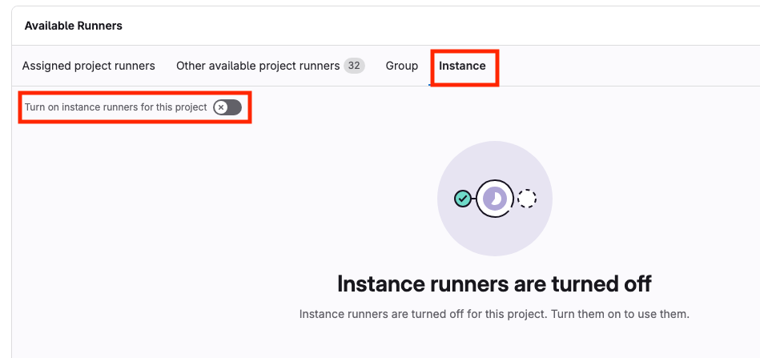
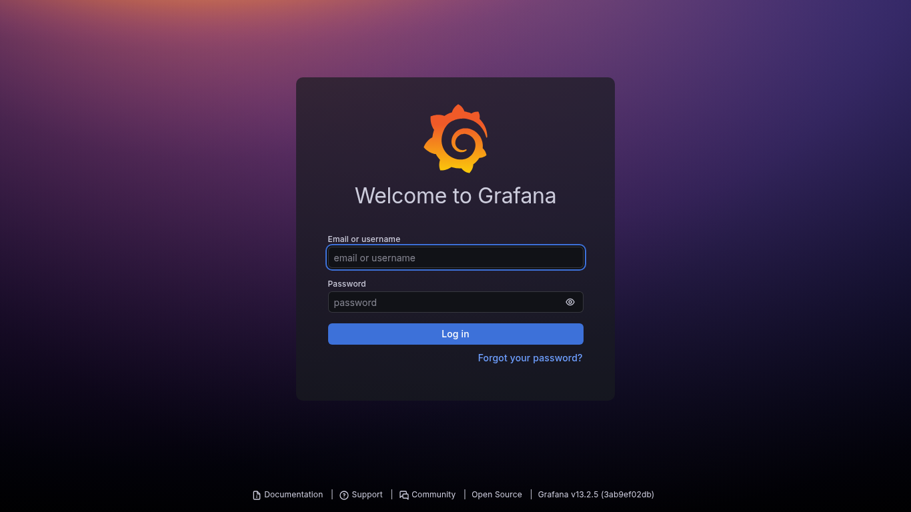
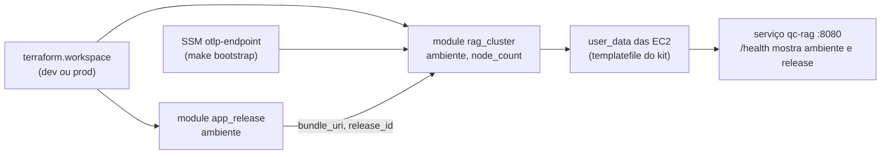
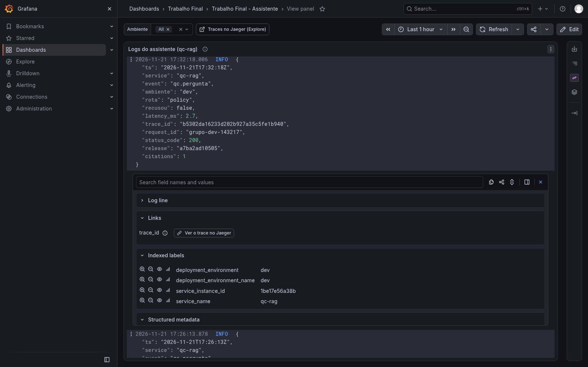

# 05 - Trabalho Final: o assistente de rastreio e políticas vai para produção

<!--
CONVENÇÃO DESTE README (nota para o professor, não aparece renderizada)

- Tempos e saídas vieram do teste real de 2026-11-21: bootstrap (1a vez 7 min 20 s, 2a 1 min 33 s),
  make validar 57 s, pipeline verde 3097623060 (590 s), pipeline sem mudança 3097640184 (315 s),
  tempos por stage dos pipelines 3097623060 e 3097640184, make destroy-ambientes 106 s rc=0 (dev 7 + prod 9 destroyed),
  checkov no runner 29 testes / 14 falhas (aba Tests 195 / 14).
  Rodada 2 (2026-11-21): telas do Grafana (prints 08 e 09), log de boot da EC2 (get-console-output) e custo (~US$ 0,197/h pela Price List) medidos.
  CONFIRMAR-SAIDA restantes = ainda não medidos (destroy-obs e destroy-runner).
- Os prints deste trabalho são Modo A (entrega do grupo): lista fechada 01 a 04 em prints/.
- Imagens de guia que faltam ficam como NOVA-IMAGEM, invisíveis ao aluno.
-->

> **Segunda-feira, 9h. Uma semana depois da Aula 5 na Quantum Commerce.**
> O **Assistente de Rastreio e Políticas** (Projeto 2) respondeu bem no laboratório: busca a política certa, cita a fonte, recusa o que não sabe e deixa rastro no Grafana. Mas ele ainda vive num ambiente só, e ninguém sabe dizer o que é "a versão de produção". **Helena Marques**, Head de Engenharia de IA e Entrega Contínua, abre a reunião com o Comitê de Tecnologia:
>
> > *— "Quero dois ambientes, **dev** e **prod**, com o mesmo código e promovidos pelo pipeline. Nada chega a prod sem três provas tiradas em dev: o assistente passou no **golden set** de perguntas, respondeu de verdade atrás do balanceador e deixou **log, métrica e trace** da pergunta. Se faltar uma, o pipeline para antes de prod."*
>
> **Diego Tavares**, AI SRE sênior, completa:
>
> > *— "O palco está pronto: um token do GitLab e um `make bootstrap` criam o projeto, o runner e a observabilidade. O assistente e os testes também já existem. O que falta é a infraestrutura dos dois ambientes e o pipeline que liga tudo. E eu vou cobrar uma coisa: quando alguém reclamar de uma resposta, eu quero achar o **trace daquela pergunta**."*

Este é o **Trabalho Final** da disciplina, feito **em grupo**. Ele junta num único projeto o que vocês praticaram nas aulas: a demo **Count** do Terraform vira um **módulo**, o **state** vai para o S3, **dev** e **prod** viram **workspaces**, e um **pipeline** no GitLab valida, planeja, confere o contrato, publica e testa o assistente nos dois ambientes, com o **gate de qualidade RAG**, o **smoke** e a **observabilidade** da Aula 5 entre dev e prod.

O assistente (código, documentos de política e golden set) e os testes vêm prontos no **kit**. O grupo escreve a infraestrutura e os jobs do pipeline. Não é preciso programar a aplicação nem mexer em IA.

Sem nota e sem peso: o objetivo é chegar ao pipeline verde até `verificar-prod`.

Os comandos rodam no **terminal do Codespaces**; a leitura do pipeline, dos testes e do Grafana acontece no **navegador**. Cada passo diz onde. Comecem pelo [Início de aula](../00-create-codespaces/Inicio-de-aula.md): ele sincroniza o fork (é o que traz esta pasta `05-Trabalho-Final/`) e recoloca credenciais AWS válidas.

Nunca usou terminal? Copie o bloco cinza inteiro, cole no terminal e aperte Enter. Se aparecer `Error`, `ERRO` ou `FAIL`, pare no passo em que está e abra o bloco **⚠ Se der erro** logo abaixo dele.

> [!WARNING]
> **Pré-requisitos obrigatórios antes de começar:**
>
> - [ ] **Codespaces aberto no fork** da disciplina, sincronizado hoje e com as **credenciais AWS do Academy** atualizadas ([Início de aula](../00-create-codespaces/Inicio-de-aula.md)).
> - [ ] Bucket **`base-config-<SEU-RM>`** criado no [setup do ambiente](../00-create-codespaces/README.md) (o mesmo das aulas de Terraform).
> - [ ] Conta no **[GitLab](https://gitlab.com)** (a mesma das aulas de CI/CD).
>
> Vocês **não** precisam de projeto GitLab, runner nem observabilidade prontos: a Parte 0 cria tudo. Se a VPC `fiap-lab` não existir mais, ela também é criada.
>
> **Valide rapidamente** (terminal do Codespaces):
>
> ```bash
> aws sts get-caller-identity --query Account --output text
> aws s3 ls | awk '/base-config-/{print $3}'
> ls /workspaces/FIAP-AI-Devops-CICD/05-Trabalho-Final/Makefile
> ```
>
> Saída esperada: o número da conta (12 dígitos), o nome do bucket `base-config-...` e o caminho do `Makefile`. `ExpiredToken` na primeira linha é credencial vencida; `No such file or directory` na última é fork desatualizado. Nos dois casos, refaçam o [Início de aula](../00-create-codespaces/Inicio-de-aula.md).
>
> **Tempo estimado: ~3 horas** para quem acompanhou as aulas, contando duas rodadas de correção. A execução pura fica perto de 40 minutos (bootstrap ~8 min, `make validar` ~1 min, primeiro pipeline completo ~10 min, os seguintes ~5 a 10 min, `make destroy-ambientes` ~2 min); o resto é ler as demos-base, escrever o Terraform e os jobs, ler a aba **Tests** e corrigir o que o pipeline apontar. Se dividirem em duas sessões, comecem a segunda pelo `make bootstrap` (religa as EC2 paradas) e pelo `make status` (passo 3).

## Principais pontos de aprendizagem

- transformar a demo Count em um **módulo** reutilizável, com a quantidade de máquinas como variável
- separar o que é do **módulo** (recursos) do que é do **raiz** (provider, backend, chamada dos módulos, leitura de parâmetros)
- guardar o **state no S3** com lock nativo e isolar **dev** e **prod** com **workspaces**
- escrever um pipeline com **`needs`** que só promove para prod depois que dev passou no gate RAG, no smoke e na observabilidade
- usar testes prontos como **contrato**: ler a aba **Tests**, achar o teste vermelho e corrigir o requisito que ele aponta
- encontrar o **log**, a **métrica** e o **trace** de uma pergunta real ao assistente, em cada ambiente

## O que vocês terão ao final

Um projeto no GitLab em que um `git push` cria do zero, testa e publica o assistente em **dev** (1 máquina) e em **prod** (2 máquinas), cada ambiente atrás do seu balanceador, com o state de cada um no seu workspace. A entrega é um `.zip` do grupo com o código e 4 prints.

**Critério de pronto:** o pipeline fica **verde até `verificar-prod`**, e o state de dev e o de prod estão nos workspaces certos (`env:/dev/...` e `env:/prod/...` no bucket). Se isso aconteceu, o trabalho está correto.

Os blocos **💡 Clique para entender** trazem o porquê, a mecânica por baixo dos comandos e links oficiais; os blocos **⚠ Se der erro** só importam se o passo falhar; os blocos **🧭 Onde está a base** apontam o lab das aulas em que vocês já fizeram algo parecido.

## Mapa do trabalho

| Parte | O que o grupo faz | Requisitos | Passos | Tempo |
|-------|-------------------|------------|--------|-------|
| [Parte 0](#parte-0---preparação-um-token-e-um-make-montam-o-palco) | Token do GitLab, `make bootstrap`, conferir runner e Grafana | | [1](#passo-1) · [2](#passo-2) · [3](#passo-3) · [4](#passo-4) | ~25 min |
| [Parte 1](#parte-1---o-módulo-rag-cluster-e-o-raiz) | Transformar a demo Count no módulo `rag-cluster` e escrever o raiz | [1](#req-1) · [2](#req-2) · [3](#req-3) · [4](#req-4) | [5](#passo-5) · [6](#passo-6) · [7](#passo-7) · [8](#passo-8) · [9](#passo-9) | ~50 min |
| [Parte 2](#parte-2---state-remoto-e-os-ambientes-dev-e-prod) | State no S3, workspaces `dev` e `prod`, validação local | [5](#req-5) · [6](#req-6) | [10](#passo-10) · [11](#passo-11) · [12](#passo-12) · [13](#passo-13) | ~25 min |
| [Parte 3](#parte-3---o-pipeline-que-promove-de-dev-para-prod) | Escrever os 6 jobs, subir, ler a aba Tests, conferir o assistente e achar o trace | [7](#req-7) · [8](#req-8) · [9](#req-9) | [14](#passo-14) · [15](#passo-15) · [16](#passo-16) · [17](#passo-17) · [18](#passo-18) · [19](#passo-19) · [20](#passo-20) · [21](#passo-21) · [22](#passo-22) · [23](#passo-23) · [24](#passo-24) · [25](#passo-25) · [26](#passo-26) · [27](#passo-27) | ~65 min |
| [Parte 4](#parte-4---empacotar-entregar-e-destruir) | Empacotar, entregar, destruir e revogar o token | [10](#req-10) | [28](#passo-28) · [29](#passo-29) · [30](#passo-30) · [31](#passo-31) · [32](#passo-32) | ~15 min |

A Parte 3 conta com uma ou duas rodadas de correção: é normal o primeiro pipeline apontar algo. Os **Requisitos** são o que o código do grupo precisa cumprir; os **passos** são a ordem de execução (é o número para citar ao pedir ajuda: "travei no passo 15").

## Contexto

Cada peça foi praticada isolada, um lab por vez. Aqui elas convivem no mesmo repositório e no mesmo fluxo:

| Peça | Onde vocês praticaram | O que muda aqui |
|------|-----------------------|-----------------|
| Frota de EC2 atrás de um ALB, com `count` | [01.3 - Count](../01-Terraform/demos/03-Count/README.md) | vira o módulo `rag-cluster`, e cada máquina roda o assistente em vez da página Nginx |
| Módulo chamado por um raiz | [01.2 - Módulos](../01-Terraform/demos/02-Modules/README.md) | o raiz chama dois módulos: o do kit (pacote do assistente) e o do grupo (a frota) |
| State no S3 com lock | [01.4 - State remoto](../01-Terraform/demos/04-State/README.md) | o mesmo backend, com a key do trabalho |
| `dev` e `prod` com workspaces | [01.5 - Workspaces](../01-Terraform/demos/05-Workspaces/README.md) e [Exercício 01.B](../01-Terraform/exercicios/State-e-workspace/README.md) | o pipeline seleciona o workspace; 1 máquina em dev, 2 em prod |
| Runner próprio na AWS | [02.1 - GitLab Runner com Ansible](../02-Ansible/01-provisionando-gitlab-runner/README.md) | o `make bootstrap` faz os 28 passos de lá sozinho |
| `plan` salvo como artefato e `apply` do plano | [03.1 - Primeiro pipeline](../03-CICD/01-Primeiro-pipeline/README.md) | dois ambientes, ligados por `needs` |
| `fmt`, Checkov, JUnit e quality gate de IA | [03.2 - Quality gates](../03-CICD/02-Validando-e-gerando-relatorios/README.md) | o gate RAG roda antes de dev, e o smoke e a observabilidade de dev antes de prod |
| Golden set, citação e recusa | [04.1 - Demo 5.1](../04-GenAIOps/01-Release-RAG-Quality-Gates/README.md) | o mesmo assistente, com o mesmo golden set, no job `rag-quality-gate` |
| Log, métrica e trace no Grafana | [04.2 - Demo 5.2](../04-GenAIOps/02-Operacao-Observabilidade-Qualidade-Continua/README.md) | o job `observabilidade-<env>` procura os três de cada pergunta, e o grupo acha o trace da própria pergunta |

| Aspecto | Resposta curta |
|---------|----------------|
| **Problema de negócio** | O assistente funciona, mas "a versão de produção" depende de quem rodou o quê. Helena quer um caminho único, do commit até prod, com provas em cada degrau. |
| **Pergunta que este trabalho responde bem** | "Conseguimos recriar o assistente do zero em dev e em prod com um push, sabendo que ele responde certo e que deixa rastro?" |
| **Pergunta que ele responde mal** | "Qual é o melhor modelo de linguagem para o assistente?" Aqui não há LLM gerativo: a resposta é montada a partir do trecho recuperado, como na Aula 5. O foco é a entrega e a operação, não o modelo. |
| **Quando acontece na vida real** | Todo time que tira um protótipo de IA do notebook e o põe em produção passa por este projeto: ambientes iguais, promoção por pipeline e observabilidade antes do primeiro cliente. |

### A arquitetura que vocês vão construir

![Arquitetura do Trabalho Final da Quantum Commerce. No Codespaces, o make bootstrap usa o token do GitLab para criar o projeto trabalho-final-ai, a chave SSH e o runner, sobe a EC2 do runner qc-runner-tf-ai e a EC2 de observabilidade qc-obs-tf-ai com Grafana, Prometheus, Loki e Jaeger, todas na VPC fiap-lab. Um git push dispara o pipeline no runner, que guarda o state no bucket base-config e publica o pacote do assistente no S3. Por workspace, o deploy cria o ALB qc-rag-alb-dev com 1 EC2 e o ALB qc-rag-alb-prod com 2 EC2, que mandam log, métrica e trace para a observabilidade.](img/arquitetura-trabalho-final.png)

*Diagrama editável na pasta [`diagramas/`](diagramas/).*

O que existe em cada camada, para não confundir infraestrutura com IA:

- **Palco** (o `make bootstrap` cria, vocês não escrevem): projeto GitLab, runner, EC2 de observabilidade com Grafana.
- **Kit** (vem pronto no clone, vocês não editam): o assistente (`app/`), o módulo que empacota o assistente (`modules/app-release/`), o script de boot das máquinas (`templates/`) e os testes (`tests/`, `validacao/`).
- **Do grupo**: o módulo `rag-cluster`, o raiz, o `backend.tf` e 6 jobs do `.gitlab-ci.yml`.

---

## Parte 0 - Preparação: um token e um make montam o palco

### Resultado esperado desta parte

O projeto `trabalho-final-ai` existe no GitLab de um integrante do grupo, o runner `qc-runner-tf-ai` aparece **online** nele, o Grafana abre com login, e o clone do projeto está em `/workspaces/trabalho-final-ai` com o kit dentro.

> [!IMPORTANT]
> **Um integrante, uma conta.** A Parte 0 e o pipeline rodam na conta AWS do Learner Lab e no GitLab de **um** integrante do grupo (quem vai compartilhar a tela). Os demais acompanham e escrevem o código junto. Rodar a Parte 0 em duas contas cria dois projetos e dois runners, sem ganho.
>
> **Cada grupo usa a SUA conta Learner Lab.** Dois projetos na mesma conta dividem o state, os nomes e o runner, e rodar o `make bootstrap` com outro `REPO` passa o runner para o projeto novo.

O Learner Lab limita a conta a ~9 EC2 ligadas ao mesmo tempo. O trabalho usa:

| EC2 | Normal | Durante a troca de release em prod |
|-----|:------:|:----------------------------------:|
| Runner `qc-runner-tf-ai` | 1 | 1 |
| Observabilidade `qc-obs-tf-ai` | 1 | 1 |
| Assistente em `dev` | 1 | 1 |
| Assistente em `prod` | 2 | 4 (2 novas sobem antes de as 2 antigas saírem) |
| **Total** | **5** | **7** |

EC2 de outros labs ainda ligadas contam no mesmo limite: destruam as que sobraram antes do `make bootstrap`.

---

<a id="passo-1"></a>

<dl>
<dt>

**1. Gere um Personal Access Token do GitLab, tipo Legacy, com escopo `api`**

</dt>
<dd>

No **navegador**, abra **[Personal access tokens](https://gitlab.com/-/user_settings/personal_access_tokens)** (o caminho pelo menu é avatar → **Edit profile** → **Access** → **Personal access tokens**). Clique em **Add new token**; nas versões mais novas da tela, o botão é **Generate token** → **Legacy token**. Se a página se chamar **Generate fine-grained token** (com "Add resource permissions" em vez de uma lista de escopos), é o tipo errado: o fine-grained não tem o escopo `api`. Volte e escolha **Legacy token**. Preencha:

| Campo | Valor |
|-------|-------|
| **Token name** | `trabalho-final-ai-bootstrap` |
| **Expiration date** | daqui a 7 dias |
| **Select scopes** | marque só **`api`** |

Clique em **Create token** (ou **Generate token**) e copie o valor que começa com `glpat-`. Ele aparece **uma vez só**: se fechar a página sem copiar, gere outro.

Não crie runner nem projeto na tela do GitLab: quem cria os dois é o `make bootstrap`, no passo seguinte.

</dd>
</dl>

> [!CAUTION]
> O token com escopo `api` age como **você** no GitLab inteiro. Cole esse valor só quando o `make bootstrap` pedir (passo 2), nunca em arquivo do repositório, chat, issue ou print. Ele fica no Codespaces, em `~/.trabalho-final-ai.env` com permissão `600`, e vocês o revogam no fim do trabalho (passo 32).

<details>
<summary><b>💡 Clique para entender: por que o escopo é <code>api</code> e o tipo é Legacy</b></summary>
<blockquote>

O bootstrap cria projeto, chave SSH e runner pela API do GitLab, e só o escopo `api` cobre as três escritas (`read_api` só lê; `create_runner` não cria projeto nem chave). O token fine-grained, mais novo, troca a lista de escopos por permissões por recurso e não oferece o `api`. A validade de 7 dias limita o estrago se ele vazar.

📚 Documentação oficial: [Personal access tokens](https://docs.gitlab.com/user/profile/personal_access_tokens/#create-a-personal-access-token), para a tela de criação; e [Access token scopes](https://docs.gitlab.com/security/tokens/access_token_scopes/), para o que cada escopo permite.

</blockquote>
</details>

---

<a id="passo-2"></a>

<dl>
<dt>

**2. Rode o `make bootstrap` e cole o token quando ele pedir**

</dt>
<dd>

No **terminal do Codespaces**, veja primeiro os comandos disponíveis:

```bash
cd /workspaces/FIAP-AI-Devops-CICD/05-Trabalho-Final
make help
```

> Saída esperada (o começo):
>
> ```text
> Trabalho Final AI-Devops-CICD - comandos (rode nesta pasta, no Codespaces)
>
>   make help               Lista os comandos disponíveis
>   make bootstrap          Cria ou reaproveita projeto GitLab, runner, observabilidade (Grafana) e clone com o kit (idempotente)
>   make status             Projeto, runner online?, observabilidade no ar?, último pipeline e DNS do ALB de dev e prod
>   ...
> ```

Agora o bootstrap. Ele pergunta o token sem mostrar o que você digita (`Cole o seu GitLab Personal Access Token (Legacy, escopo api; não aparece na tela):`): cole o `glpat-...` do passo 1 e tecle **Enter**. Nada aparece na tela enquanto você cola, e isso é o esperado.

```bash
cd /workspaces/FIAP-AI-Devops-CICD/05-Trabalho-Final
make bootstrap REPO=trabalho-final-ai
```

O comando leva **~8 minutos** na primeira vez (7 min 20 s no teste de referência; etapas `1/11` a `11/11` no log) e ~1 min 30 s nas seguintes, quase todos subindo e configurando as EC2 do runner e da observabilidade. **Enquanto ele roda, leiam a [Parte 1](#parte-1---o-módulo-rag-cluster-e-o-raiz) inteira** e abram a [demo Count](../01-Terraform/demos/03-Count/main.tf) no editor: é o código que vocês vão transformar.

> Saída esperada (o fim; ids, IPs e usuário são os seus):
>
> ```text
> Bootstrap concluído em 7 min 20 s.
>   Projeto GitLab : https://gitlab.com/seu-usuario/trabalho-final-ai
>   Pasta do clone : /workspaces/trabalho-final-ai (branch master)
>   Runner         : qc-runner-tf-ai (id 12345678, online) na EC2 i-0abc123def4567890
>   Observabilidade: qc-obs-tf-ai na EC2 i-0def456abc7890123
>   Grafana        : http://203.0.113.10:3000  (usuário admin; senha: make grafana-senha)
>   OTLP (apps)    : SSM /fiap/trabalho-final-ai/otlp-endpoint
> ```

O token fica salvo em `~/.trabalho-final-ai.env`, e os próximos `make` não pedem de novo. **Pode rodar o bootstrap quantas vezes precisar**: cada etapa confere o que já existe e só cria o que falta.

</dd>
</dl>

<details>
<summary><b>💡 Clique para entender: o que cada comando do <code>make</code> faz de verdade</b></summary>
<blockquote>

Todos rodam a partir de `/workspaces/FIAP-AI-Devops-CICD/05-Trabalho-Final`. Nenhum deles destrói a VPC `fiap-lab` nem o bucket.

| Comando | O que executa por baixo | Quando usar |
|---------|-------------------------|-------------|
| `make help` | Lista os alvos com a descrição de cada um. | Para lembrar os nomes. |
| `make bootstrap REPO=...` | `bootstrap/bootstrap.sh`, em 11 etapas: preflight, rede, ferramentas, chave SSH, projeto, runner no GitLab e token no SSM, EC2 do runner (Terraform), EC2 de observabilidade (Terraform), configuração do runner (Ansible via SSM), espera do runner `online`, prova de observabilidade e clone com o kit. | No começo, e de novo sempre que algo da preparação quebrar ou uma EC2 ficar parada. É idempotente. |
| `make status` | `bootstrap/status.sh`, só leitura: projeto e runner pela API do GitLab, observabilidade no ar, último pipeline e o `alb_dns` de `dev` e de `prod` lido do state no S3. | Ao voltar ao trabalho, e sempre que um pipeline ficar `pending`. |
| `make links` | `bootstrap/links.sh`: monta os links do projeto, de `pipelines`, de `runners`, do `grafana` e dos dois ambientes (`assistente-dev`, `assistente-prod`). Com um nome (`make links grafana`), imprime só aquele. | Sempre que precisar abrir uma tela, em vez de navegar por menus. |
| `make grafana-senha` | Lê a senha do admin do Grafana do SSM (`/fiap/trabalho-final-ai/grafana-admin`, SecureString) e mostra só no seu terminal. | No login do Grafana (passo 4). |
| `make validar` | `bootstrap/validar.sh validar` no clone: `fmt -check`, `init`, `validate`, `terraform test`, o gate RAG, `plan` de `dev` e de `prod` e o `test_contrato.py` sobre cada plano. **Não roda `apply`.** | Antes de cada `push`: os mesmos testes de contrato do pipeline, sem criar nada. |
| `make smoke` | `bootstrap/validar.sh smoke`: o `test_smoke.py` contra `dev` e `prod` já no ar, a partir do Codespaces (`AMBIENTE=dev` testa só um). | Depois do deploy, para conferir sem esperar outro pipeline. |
| `make kit` | Recopia para o clone os arquivos do kit que estiverem diferentes. Não toca em nenhum arquivo do grupo. | Se alguém apagou ou alterou um arquivo do kit sem querer. |
| `make destroy` | `destroy.sh tudo`: ambientes `dev` e `prod`, runner e observabilidade. **Apaga TUDO deste trabalho de uma vez.** | Só se quiserem derrubar tudo junto; no passo 31 usamos os três alvos abaixo, um por vez. |
| `make destroy-ambientes` | No clone: `terraform destroy` nos workspaces `dev` e `prod`. | Para derrubar só o assistente e manter o palco. |
| `make destroy-runner` | Destrói a EC2 do runner, apaga o runner no GitLab e o token no SSM. | Para derrubar só o runner. |
| `make destroy-obs` | Destrói a EC2 de observabilidade e os parâmetros SSM dela. | Para derrubar só a observabilidade. |

</blockquote>
</details>

<details>
<summary><b>💡 Clique para entender: como <code>make bootstrap</code> faz cada etapa por baixo dos panos</b></summary>
<blockquote>

A numeração é a mesma do log. Cada etapa confere antes de criar; é isso que torna seguro rodar de novo.

1. **Preflight.** `aws sts get-caller-identity` confirma a credencial e `aws s3api list-buckets` acha o bucket `base-config-*`. No GitLab, `GET /user` valida o token e descobre o seu usuário, e `GET /personal_access_tokens/self` confere que a lista `scopes` contém `api`. Só então o token é gravado em `~/.trabalho-final-ai.env` (`chmod 600`).
2. **Rede.** Se a VPC `fiap-lab` não existe, aplica `vpc-call` e `RT-call` da [demo 01.2](../01-Terraform/demos/02-Modules/README.md), que só criam.
3. **Ferramentas.** Garante o `session-manager-plugin` e o venv do Ansible com as collections da AWS.
4. **Chave SSH.** Gera `~/.ssh/gitlab` se não existir, cadastra a pública com `POST /user/keys` e escreve o bloco `Host gitlab.com` no `~/.ssh/config`. Por isso este trabalho não precisa de `ssh-agent`.
5. **Projeto.** `POST /projects` (`visibility=public`, sem README) e `PUT /projects/:id` com `shared_runners_enabled=false`, para os jobs não caírem nos runners compartilhados do GitLab, que não têm credencial AWS.
6. **Runner no GitLab.** `POST /user/runners` (`runner_type=project_type`, tags `shell` e `terraform`). O token `glrt-` da resposta vai direto para o SSM, em `/fiap/trabalho-final-ai/runner-token` (SecureString), sem passar pela tela.
7. **EC2 do runner.** `terraform apply` em `bootstrap/runner/` (a mesma EC2 do Módulo 02, com o nome `qc-runner-tf-ai`), state em `s3://base-config-.../trabalho-final-ai/runner.tfstate`. Se a EC2 estiver parada, ela é religada.
8. **Observabilidade.** `terraform apply` em `bootstrap/obs/`: a EC2 `qc-obs-tf-ai` (`t3.medium`) com Docker Compose rodando o OpenTelemetry Collector, o Prometheus, o Loki, o Jaeger e o Grafana. O endereço OTLP privado vai para `/fiap/trabalho-final-ai/otlp-endpoint`, e os endereços de consulta, para `/fiap/trabalho-final-ai/obs-query`.
9. **Configuração do runner.** `ansible-playbook` com o mesmo `play.yaml` do Módulo 02, pelo plugin `aws_ssm` (sem SSH e sem porta 22): Terraform 1.10.5, `/opt/venv` com Checkov, pytest e `boto3`, e o `gitlab-runner` registrado com o token lido do SSM.
10. **Espera e prova.** Consulta `GET /runners/:id` até o `status` virar `online`, espera a observabilidade responder e manda um trace de teste a partir do runner até o Jaeger.
11. **Clone e kit.** `git clone` em `/workspaces/trabalho-final-ai`, copia o kit, faz o commit `chore: kit de validacao do trabalho final` e o push para `master`. Como ainda não há `.gitlab-ci.yml`, nenhum pipeline roda.

📚 Documentação oficial: [Projects API: Create a project](https://docs.gitlab.com/api/projects/#create-a-project), para `visibility` e `shared_runners_enabled`; [Users API: Create a runner linked to a user](https://docs.gitlab.com/api/users/#create-a-runner-linked-to-a-user), para o token `glrt-`; e [Parameter Store: SecureString](https://docs.aws.amazon.com/systems-manager/latest/userguide/sysman-paramstore-securestring.html), para como o token fica criptografado.

</blockquote>
</details>

<details>
<summary><b>⚠ Se der erro: <code>ERRO: o token não tem o escopo 'api'</code></b></summary>
<blockquote>

O token é fine-grained ou foi criado sem o `api`. Gere um **Legacy token** com escopo `api` (passo 1), apague o token salvo e rode de novo (ele pergunta o token outra vez):

```bash
rm -f ~/.trabalho-final-ai.env
cd /workspaces/FIAP-AI-Devops-CICD/05-Trabalho-Final
make bootstrap REPO=trabalho-final-ai
```

</blockquote>
</details>

<details>
<summary><b>⚠ Se der erro: <code>ERRO: o GitLab recusou o token (401 Unauthorized)</code></b></summary>
<blockquote>

O token foi colado incompleto, expirou ou foi revogado. Gere outro (passo 1) e rode o mesmo bloco do erro anterior: `rm -f ~/.trabalho-final-ai.env` e o `make bootstrap`.

</blockquote>
</details>

<details>
<summary><b>⚠ Se der erro: <code>ERRO: credenciais AWS inválidas ou expiradas</code> ou <code>ExpiredToken</code></b></summary>
<blockquote>

A sessão do Learner Lab venceu. Recoloque as credenciais ([Início de aula](../00-create-codespaces/Inicio-de-aula.md)) e rode o `make bootstrap` de novo: ele retoma de onde parou.

</blockquote>
</details>

<details>
<summary><b>⚠ Se der erro: <code>ERRO: nenhum bucket 'base-config-*' encontrado na conta AWS</code></b></summary>
<blockquote>

O bucket do setup não existe nesta conta. Crie-o pelo [setup do ambiente](../00-create-codespaces/README.md) e rode o `make bootstrap` de novo.

</blockquote>
</details>

<details>
<summary><b>⚠ Se der erro: <code>ERRO: existem 2 VPCs com a tag Name=fiap-lab; o Terraform exige exatamente uma.</code></b></summary>
<blockquote>

Um Codespace novo rodou a demo 01.2 de novo e criou uma segunda rede `fiap-lab`. A mensagem traz o comando que lista as duas. Não apaguem nenhuma sem falar com o professor: as demos e outros trabalhos podem estar usando uma delas. Se a conta foi resetada e não há rede nenhuma, o próprio bootstrap a cria; para recriar só a rede, existe o `bash /workspaces/FIAP-AI-Devops-CICD/01-Terraform/scripts/recriar-rede.sh`.

</blockquote>
</details>

<details>
<summary><b>⚠ Se der erro: já existe um projeto <code>trabalho-final-ai</code> seu, de outra tentativa ou disciplina</b></summary>
<blockquote>

O bootstrap reaproveita um projeto com o mesmo nome e misturaria o kit ao código antigo. Use outro nome, por exemplo `make bootstrap REPO=trabalho-final-ai-grupo`, e troque `/workspaces/trabalho-final-ai` por `/workspaces/trabalho-final-ai-grupo` em todos os comandos deste README.

Na mesma conta AWS, o projeto novo reaproveita o mesmo runner, a mesma observabilidade e o mesmo state do antigo (os nomes são fixos): um projeto por conta.

</blockquote>
</details>

<details>
<summary><b>⚠ Se o bootstrap avisar: <code>AVISO: o runner qc-runner-tf-ai está ligado ao projeto id ...; ele passa agora para ...</code></b></summary>
<blockquote>

A mensagem completa é parecida com esta:

```text
AVISO: o runner qc-runner-tf-ai está ligado ao projeto id 89123456; ele passa agora para seu-usuario/trabalho-final-ai-grupo (id 89278022). Pipelines do projeto antigo ficam 'pending' (um runner por conta AWS).
```

Não é erro, e o bootstrap segue. A conta AWS tem uma EC2 de runner só, e ela acabou de ser registrada no projeto novo: o projeto antigo fica sem runner, e qualquer pipeline dele espera em `pending` para sempre (a tela do GitLab ainda mostra o runner antigo `online` por alguns minutos). Se o projeto antigo não serve mais, ignorem. Se era o projeto certo, rodem o `make bootstrap` de novo com o `REPO` dele, e o runner volta.

</blockquote>
</details>

<details>
<summary><b>⚠ Se der erro: o runner não fica <code>online</code> ou o Ansible para com <code>failed=1</code></b></summary>
<blockquote>

Rode o `make bootstrap` de novo: ele religa a EC2 se ela estiver parada e reaplica o playbook. Se continuar, o `PLAY RECAP` do Ansible mostra `failed=1` e o nome da task que quebrou; copie esse trecho ao pedir ajuda.

</blockquote>
</details>

---

<a id="passo-3"></a>

<dl>
<dt>

**3. Confira com `make status` o runner online e o clone com o kit**

</dt>
<dd>

```bash
cd /workspaces/FIAP-AI-Devops-CICD/05-Trabalho-Final
make status
```

> Saída esperada (ids, IPs e URLs são os seus):
>
> ```text
> Trabalho Final AI-Devops-CICD - status
>   Projeto          https://gitlab.com/seu-usuario/trabalho-final-ai (id 12345678)
>   Runner           qc-runner-tf-ai (id 12345678): online
>   Último pipeline  nenhum pipeline ainda (faça o primeiro push com o .gitlab-ci.yml)
>   Observabilidade  qc-obs-tf-ai (i-0def456abc7890123) no ar; Grafana http://203.0.113.10:3000 (health 200)
>   OTLP (SSM)       http://10.0.1.25:4318
>   ALB dev          sem state ou sem output alb_dns (o deploy-dev ainda não rodou)
>   ALB prod         sem state ou sem output alb_dns (o deploy-prod ainda não rodou)
> ```

As linhas que importam agora são a do **Runner**, terminando em `online`, e a da **Observabilidade**, com `no ar`. Pipeline e ALBs aparecem na Parte 3.

Depois confira o clone:

```bash
cd /workspaces/trabalho-final-ai
ls -A
git log --oneline
```

> Saída esperada (o hash é outro no seu clone):
>
> ```text
> .git  .gitignore  app  ci  modules  templates  tests  validacao
> 1a2b3c4 (HEAD -> master, origin/master) chore: kit de validacao do trabalho final
> ```

</dd>
</dl>

Agora confira, no GitLab, que os jobs só podem cair no **seu** runner. Primeiro gere o link:

<dl>
<dt>

**3.1. Gere o link da tela de runners**

</dt>
<dd>

```bash
cd /workspaces/FIAP-AI-Devops-CICD/05-Trabalho-Final
make links runners
```

**Esperado:** uma linha só, a URL `https://gitlab.com/seu-usuario/trabalho-final-ai/-/settings/ci_cd#js-runners-settings` (com o seu usuário).

</dd>
<dt>

**3.2. Abra o link e confira as duas abas**

</dt>
<dd>

Ctrl+clique (Cmd+clique no Mac) no link para abrir no navegador (é **Settings → CI/CD → Runners**). Confira:

- aba **Assigned project runners**: o `qc-runner-tf-ai` com a bolinha verde;
- aba **Instance**: a chave **Turn on instance runners for this project** **desligada**, com a mensagem *Instance runners are turned off*.

O bootstrap desliga essa chave pela API, mas confiram na tela: ligada, o GitLab pode mandar os jobs para os runners compartilhados dele, que não têm credencial da sua conta AWS, e o pipeline quebra no `terraform init`. É a mesma chave do [passo 12 do Lab 02.1](../02-Ansible/01-provisionando-gitlab-runner/README.md#passo-12).



</dd>
</dl>

<details>
<summary><b>💡 Clique para entender: como <code>make status</code> descobre cada informação</b></summary>
<blockquote>

O `status.sh` só consulta. Projeto, runner e último pipeline vêm da API do GitLab (`GET /projects/:id/runners?type=project_type` e `GET /projects/:id/pipelines?per_page=1`); o `status` do runner é `online`, `offline`, `stale` ou `never_contacted`, e `offline` quer dizer EC2 desligada ou serviço parado. O DNS de cada ALB sai direto do objeto de state no bucket (`env:/dev/trabalho-final-ai/terraform.tfstate` e o de `prod`), campo `outputs.alb_dns.value`, sem `terraform init`.

📚 Documentação oficial: [Runners API: List all of a project's runners](https://docs.gitlab.com/api/runners/#list-all-of-a-projects-runners), para os filtros e o campo `status`.

</blockquote>
</details>

---

<a id="passo-4"></a>

<dl>
<dt>

**4. Pegue a senha do Grafana**

</dt>
<dd>

O Grafana é a tela de observabilidade do trabalho: é nele que o grupo vai achar o trace de uma pergunta (Requisito 9). Ele abre com login: usuário `admin` e uma senha gerada pelo bootstrap.

```bash
cd /workspaces/FIAP-AI-Devops-CICD/05-Trabalho-Final
make grafana-senha
```

**Esperado:** uma linha com a senha. Ela aparece só no seu terminal: não cole em print, chat nem arquivo do repositório.

</dd>
<dt>

**4.1. Gere o link do Grafana**

</dt>
<dd>

```bash
cd /workspaces/FIAP-AI-Devops-CICD/05-Trabalho-Final
make links grafana
```

**Esperado:** uma linha só, a URL `http://203.0.113.10:3000/d/qc-tf-assistente` (o IP é o da sua EC2 `qc-obs-tf-ai`).

</dd>
<dt>

**4.2. Abra o Grafana e entre**

</dt>
<dd>

Ctrl+clique (Cmd+clique no Mac) no link para abrir no navegador. Na tela de login, **Email or username** = `admin`, **Password** = a senha do passo 4, e clique em **Log in**.



**Esperado:** o painel **Trabalho Final - Assistente** abre, ainda vazio (nenhum ambiente subiu). Deixem a aba aberta: ela volta no Requisito 9.

</dd>
</dl>

<details>
<summary><b>⚠ Se der erro: o Grafana não abre (a página fica carregando ou dá <code>ERR_CONNECTION_TIMED_OUT</code>)</b></summary>
<blockquote>

A EC2 de observabilidade está parada (a AWS Academy para as instâncias no fim da sessão) ou o IP público mudou ao religar. Rode o `make bootstrap` (ele religa a EC2 e espera a observabilidade responder) e gere o link de novo com `make links grafana`: o IP pode ser outro.

</blockquote>
</details>

### Checkpoint

- [ ] O projeto `trabalho-final-ai` existe no GitLab.
- [ ] O `make status` mostra o runner `qc-runner-tf-ai` **online**.
- [ ] `/workspaces/trabalho-final-ai` tem `app/`, `ci/`, `modules/app-release/`, `templates/`, `tests/` e `validacao/`.
- [ ] Na aba **Instance** da tela de runners, *Instance runners are turned off*.
- [ ] O Grafana abriu com login no painel **Trabalho Final - Assistente**.

---

> [!IMPORTANT]
> **Daqui em diante começa o trabalho que o grupo desenvolve.** O palco está pronto. A partir da Parte 1, o código é de vocês: o módulo `rag-cluster`, o raiz, o backend e os jobs do `.gitlab-ci.yml`.

Vocês desenvolvem **dentro do clone**, em `/workspaces/trabalho-final-ai`: é dele que sai o `git push` da Parte 3. Ele fica ao lado do repositório do curso e pode não aparecer no explorer do Codespaces; para abrir um arquivo no editor, use `code` com o caminho (os passos trazem o comando).

O kit que veio no clone é o **contrato** que o código do grupo precisa cumprir. Não editem esses arquivos: o pipeline usa exatamente eles.

| Arquivo do kit | O que é | Quem usa |
|----------------|---------|----------|
| `app/` | O assistente da Aula 5: servidor HTTP na porta 8080 (`/health` e `/assistant/ask`), corpus de políticas, golden set e telemetria OTLP. | O módulo `app-release` empacota; as EC2 rodam |
| `modules/app-release/` | Módulo pronto: zipa `app/` e publica em `s3://base-config-.../trabalho-final-ai/releases/<env>/app-<hash>.zip`. Outputs `bundle_uri` e `release_id`. | O raiz do grupo chama |
| `templates/user_data.sh.tftpl` | Script de boot das EC2: baixa o pacote do S3, instala e liga o serviço `qc-rag` na porta 8080. Recebe 5 variáveis. | O módulo `rag-cluster` do grupo usa com `templatefile` |
| `ci/kit-jobs.yml` | Os 8 jobs do kit e os 7 stages, com os lugares `(seu)` marcados. | Vira o `.gitlab-ci.yml` no passo 14 |
| `tests/modulo.tftest.hcl` | `terraform test` do módulo `rag-cluster` isolado, com 1 e 2 máquinas. | Job `tf-test` e `make validar` |
| `validacao/test_rag_gate.py` | O gate de qualidade RAG: golden set contra `app/`, com os limiares de `app/evals/thresholds.json`. | Job `rag-quality-gate` |
| `validacao/test_contrato.py` | O plano de cada ambiente e o próprio `.gitlab-ci.yml`: backend, módulos, nomes, quantidades, outputs, jobs e `needs`. | Jobs `contrato-<env>` e `make validar` |
| `validacao/test_smoke.py` | O assistente no ar: `/health` com o ambiente e o release certos, uma pergunta respondida com citação, máquinas e alvos saudáveis. | Jobs `smoke-<env>` e `make smoke` |
| `validacao/test_observabilidade.py` | Manda perguntas ao ALB e procura cada uma no Prometheus (métrica), no Loki (log) e no Jaeger (trace). | Jobs `observabilidade-<env>` |
| `.gitignore` | Deixa `.terraform/`, state, planos, `build/` e relatórios fora do Git. | Em todo `git add` |

---

## Parte 1 - O módulo rag-cluster e o raiz

### Resultado esperado desta parte

A demo Count vira o módulo `modules/rag-cluster/`, que sobe N máquinas rodando o assistente atrás de um ALB, e um `main.tf` raiz chama os dois módulos (o do kit e o do grupo). `terraform validate` passa.

> *— "A demo Count já é quase o que precisamos: uma frota atrás de um balanceador. Só que cada máquina tem que rodar o assistente, e não uma página estática."* (Diego)

O que muda da demo para o módulo, numa frase por peça:

| Na demo Count | No módulo `rag-cluster` | Por quê |
|---------------|-------------------------|---------|
| `provider "aws"` no `main.tf` | sai do módulo, vai para o raiz | quem chama decide região e credenciais |
| `count = 2` | `count = var.node_count` | dev usa 1 máquina, prod usa 2 |
| Amazon Linux + `script.sh` + `site/` via SSM (`terraform_data.provisiona`) | Ubuntu 22.04 + `user_data` do kit | a máquina se instala sozinha no primeiro boot, a partir do pacote no S3 |
| Nginx na porta 80, health check em `/` | assistente na porta 8080, health check em `/health` | é onde o `app/server.py` responde |
| nomes fixos `quantum-ai-*`, `nginx-00N` | nomes com o ambiente, `qc-rag-*` | dev e prod convivem na mesma conta |
| `check.tf` (provider `http`) | sai | quem prova que o assistente está no ar é o job `smoke-<env>` |

---

<a id="req-1"></a>

### Requisito 1. Copiar a demo Count para a pasta do módulo

<a id="passo-5"></a>

**5. Copie a demo Count para o módulo e tire o que o kit substitui**

Três sub-passos, na ordem: copiar, apagar arquivos, apagar blocos.

<dl>
<dt>

**5.1. Copie TODOS os arquivos da demo Count para `modules/rag-cluster/`**

</dt>
<dd>

O bloco só copia se a pasta ainda não tem o `main.tf`: colado de novo depois de editar, ele não apaga o trabalho do grupo.

```bash
cd /workspaces/trabalho-final-ai
if [ ! -f modules/rag-cluster/main.tf ]; then
  mkdir -p modules/rag-cluster
  cp -r /workspaces/FIAP-AI-Devops-CICD/01-Terraform/demos/03-Count/*.tf \
        /workspaces/FIAP-AI-Devops-CICD/01-Terraform/demos/03-Count/script.sh \
        /workspaces/FIAP-AI-Devops-CICD/01-Terraform/demos/03-Count/site \
        modules/rag-cluster/
fi
ls modules/rag-cluster
```

> Saída esperada:
>
> ```text
> check.tf  main.tf  outputs.tf  script.sh  securitygroup.tf  site  variables.tf  versions.tf
> ```

</dd>
<dt>

**5.2. Apague os arquivos que o `user_data` do kit substitui**

</dt>
<dd>

O `script.sh`, a página `site/` e o `check.tf` eram o provisionamento e a checagem da página Nginx. Aqui quem instala é o `templates/user_data.sh.tftpl` do kit, e quem testa é o smoke.

```bash
cd /workspaces/trabalho-final-ai
rm -rf modules/rag-cluster/check.tf modules/rag-cluster/script.sh modules/rag-cluster/site
ls modules/rag-cluster
```

> Saída esperada:
>
> ```text
> main.tf  outputs.tf  securitygroup.tf  variables.tf  versions.tf
> ```

</dd>
<dt>

**5.3. Apague do `main.tf` o `provider "aws"` e o `terraform_data.provisiona`**

</dt>
<dd>

```bash
cd /workspaces/trabalho-final-ai
code modules/rag-cluster/main.tf
```

No editor, tire dois blocos e salve. O `provider "aws" { ... }` do topo (do comentário `# Provider declarado uma vez na raiz desta demo.` até a chave que fecha o provider): recortem e guardem, porque ele vira o do raiz no passo 8.2. E o `resource "terraform_data" "provisiona" { ... }` inteiro, com o comentário acima dele: esse pode apagar. Depois, no `versions.tf` do módulo (`code modules/rag-cluster/versions.tf`), apague o bloco `http = { ... }`, que só o `check.tf` usava.

Confira que não sobrou nada:

```bash
cd /workspaces/trabalho-final-ai
grep -rnE 'provider "aws"|terraform_data|hashicorp/http' modules/rag-cluster || echo "modulo limpo"
```

> Saída esperada:
>
> ```text
> modulo limpo
> ```

Mantenham os nomes locais dos recursos como vieram da demo (`aws_instance.web`, `aws_lb.web`, `aws_lb_target_group.web`, `aws_lb_listener.web`, `aws_security_group.web`, `aws_lb_target_group_attachment.web`): os testes do kit procuram por eles.

</dd>
</dl>

🧭 **Onde está a base:** a demo inteira está em [01.3 - Count](../01-Terraform/demos/03-Count/README.md); a fronteira entre módulo e raiz, em [01.2 - Módulos](../01-Terraform/demos/02-Modules/README.md).

<details>
<summary><b>💡 Clique para entender: por que o provider sai do módulo</b></summary>
<blockquote>

Um módulo é como uma função: variáveis são os parâmetros, outputs são o retorno. O provider é decisão de quem chama (região, credenciais, tags padrão). Um módulo com provider próprio não aceita `count` nem `for_each` no bloco `module` e prende quem o usa a uma região. Por isso o contrato do kit reprova provider dentro de `modules/`.

📚 Documentação oficial: [Providers within modules](https://developer.hashicorp.com/terraform/language/modules/develop/providers), para a regra de deixar o provider no raiz.

</blockquote>
</details>

<details>
<summary><b>⚠ Se der erro: <code>Call to function "filesha256" failed: open .../script.sh: no such file or directory</code></b></summary>
<blockquote>

O `terraform_data.provisiona` ainda está no `main.tf` do módulo e procura o `script.sh` que o passo 5.2 apagou. Apague o bloco inteiro (passo 5.3).

</blockquote>
</details>

---

<a id="req-2"></a>

### Requisito 2. Trocar a página Nginx pelo assistente

<a id="passo-6"></a>

**6. Troque a página Nginx pelo assistente**

Cada máquina passa a rodar o assistente da Aula 5. Quem instala é o script do kit: o módulo só precisa entregar a ele cinco valores.

<dl>
<dt>

**6.1. Troque a AMI Amazon Linux pela Ubuntu 22.04**

</dt>
<dd>

O script do kit usa `apt`, então a máquina é Ubuntu 22.04. No `variables.tf` do módulo, apague o `data "aws_ami" "amazon_linux"`. No `main.tf`, declare um `data "aws_ami" "ubuntu"` e use-o no `ami` do `aws_instance.web`.

🧭 **Código parecido:** o runner do curso já busca essa mesma AMI. Copie o bloco `data "aws_ami" "ubuntu"` de [`02-Ansible/.../terraform-gitlab-runner/instance.tf`](../02-Ansible/01-provisionando-gitlab-runner/terraform-gitlab-runner/instance.tf) (as linhas 1 a 16).

</dd>
<dt>

**6.2. Ligue o `user_data` do kit com `templatefile`**

</dt>
<dd>

No `aws_instance.web`, três atributos novos:

| Atributo | Valor |
|----------|-------|
| `user_data` | `templatefile("${path.module}/../../templates/user_data.sh.tftpl", { ... })`, com exatamente estas 5 chaves: `ambiente`, `release_id`, `bundle_uri`, `otlp_endpoint`, `aws_region`, cada uma recebendo a variável de mesmo nome (Requisito 3) |
| `user_data_replace_on_change` | `true` |
| `lifecycle { create_before_destroy = true }` | um bloco `lifecycle` dentro do recurso |

O caminho começa em `${path.module}` e sobe duas pastas porque o template mora na raiz do projeto (`templates/`), e o módulo, em `modules/rag-cluster/`.

🧭 **Código parecido:** a EC2 de observabilidade da Aula 5 usa `templatefile` do mesmo jeito, com duas chaves: [`04-GenAIOps/quantum-assistant/infra-obs/ec2.tf`](../04-GenAIOps/quantum-assistant/infra-obs/ec2.tf), linhas 35 a 38.

</dd>
<dt>

**6.3. Mude a porta para 8080 e o health check para `/health`**

</dt>
<dd>

O assistente responde na 8080. O ALB continua recebendo o público na 80 e encaminha para a 8080 das máquinas.

| Recurso | O que muda |
|---------|-----------|
| `aws_lb_target_group.web` | `port = 8080` e, no `health_check`, `path = "/health"` |
| `aws_lb_target_group_attachment.web` | `port = 8080` |
| `aws_security_group.web` (`securitygroup.tf`) | um segundo `ingress` na 8080, aceitando só quem tem o mesmo Security Group (`self = true`): o ALB e as máquinas usam este SG, então só o ALB alcança a 8080 |
| `aws_lb_listener.web` | nada: continua na 80 |

Em uma frase: o Security Group é o firewall da máquina, e `self = true` quer dizer "aceite só quem também usa este mesmo firewall".

🧭 **Código parecido:** o `ingress` da porta 80 no `securitygroup.tf` da demo Count (linhas 15 a 20, que vocês copiaram no passo 5.1). Copiem o bloco, troquem a porta para 8080 e, no lugar de `cidr_blocks`, usem `self = true` ([aws_security_group: ingress](https://registry.terraform.io/providers/hashicorp/aws/latest/docs/resources/security_group#self-1)).

</dd>
</dl>

<details>
<summary><b>💡 Clique para entender: o que o <code>user_data</code> do kit faz no primeiro boot</b></summary>
<blockquote>

O `templatefile` lê o arquivo `.tftpl` e troca cada `${ambiente}`, `${release_id}` etc. pelo valor que o módulo passou; o resultado é o script que a EC2 roda uma vez, no primeiro boot (cloud-init). O script do kit instala `python3-venv` e `awscli`, copia o pacote do S3 (`aws s3 cp` do `bundle_uri`, com a `LabRole` do `LabInstanceProfile`), extrai em `/opt/qc-rag/app`, cria o venv com as bibliotecas do OpenTelemetry e liga o serviço `qc-rag.service` na porta 8080, com `AMBIENTE`, `RELEASE_ID` e `OTEL_EXPORTER_OTLP_ENDPOINT` no ambiente. O log fica em `/var/log/qc-rag-bootstrap.log`.

Como o `user_data` só roda no primeiro boot, um pacote novo exige uma máquina nova: é o `user_data_replace_on_change = true`. E o `create_before_destroy` cria a máquina nova **antes** de apagar a antiga, para a troca de versão não derrubar o ambiente.

📚 Documentação oficial: [`templatefile`](https://developer.hashicorp.com/terraform/language/functions/templatefile), para a sintaxe das variáveis do template; e [`aws_instance`: `user_data_replace_on_change`](https://registry.terraform.io/providers/hashicorp/aws/latest/docs/resources/instance#user_data_replace_on_change), para o efeito de recriar a instância.

</blockquote>
</details>

<details>
<summary><b>⚠ Se der erro: <code>Invalid value for "vars" parameter: vars map does not contain key "..."</code></b></summary>
<blockquote>

O mapa do `templatefile` não tem uma das 5 chaves que o template usa (`ambiente`, `release_id`, `bundle_uri`, `otlp_endpoint`, `aws_region`). O nome da chave tem que ser idêntico, sem `var.` na frente: `ambiente = var.ambiente`.

</blockquote>
</details>

<details>
<summary><b>⚠ Se der erro: <code>Invalid value for "path" parameter: no file exists at ".../templates/user_data.sh.tftpl"</code></b></summary>
<blockquote>

O caminho não sai de `${path.module}` ou não sobe as duas pastas. Use exatamente `"${path.module}/../../templates/user_data.sh.tftpl"`. Se o arquivo sumiu do clone, `make kit` o recoloca.

</blockquote>
</details>

---

<a id="req-3"></a>

### Requisito 3. Receber o ambiente por variável e nomear tudo por ele

<a id="passo-7"></a>

**7. Receba o ambiente por variável e nomeie tudo por ele**

<dl>
<dt>

**7.1. Declare as variáveis do módulo no `variables.tf`**

</dt>
<dd>

| Variável | Tipo | Default | De onde vem |
|----------|------|---------|-------------|
| `ambiente` | `string` | **sem default** | o raiz passa `terraform.workspace` |
| `node_count` | `number` | **sem default** | o raiz decide: 1 em dev, 2 em prod |
| `bundle_uri` | `string` | **sem default** | output do módulo `app-release` |
| `release_id` | `string` | **sem default** | output do módulo `app-release` |
| `otlp_endpoint` | `string` | **sem default** | o raiz lê do SSM |
| `aws_region` | `string` | `"us-east-1"` | já existe na demo |
| `instance_type` | `string` | `"t3.micro"` | já existe na demo |

Sem default é de propósito: se o raiz esquecer um valor, o Terraform para com `Missing required argument`, em vez de subir prod com um valor de dev.

</dd>
<dt>

**7.2. Troque o `count = 2` por `var.node_count`**

</dt>
<dd>

No `aws_instance.web`. O `count` do `aws_lb_target_group_attachment.web` já usa `length(aws_instance.web)` e acompanha sozinho.

</dd>
<dt>

**7.3. Nomeie cada recurso com o ambiente**

</dt>
<dd>

Use `var.ambiente` (o módulo não lê o workspace: quem lê é o raiz). Os nomes esperados:

| Recurso (arquivo) | Na demo | Em `dev` | Em `prod` |
|-------------------|---------|----------|-----------|
| `aws_instance.web`, tag `Name` (`main.tf`) | `nginx-001`, `nginx-002` | `qc-rag-dev-001` | `qc-rag-prod-001`, `qc-rag-prod-002` |
| `aws_lb.web` (`main.tf`) | `quantum-ai-alb` | `qc-rag-alb-dev` | `qc-rag-alb-prod` |
| `aws_lb_target_group.web` (`main.tf`) | `quantum-ai-tg` | `qc-rag-tg-dev` | `qc-rag-tg-prod` |
| `aws_security_group.web`, no `name` **e** na tag `Name` (`securitygroup.tf`) | `quantum-ai-http` | `qc-rag-dev` | `qc-rag-prod` |

A demo monta a tag com `format("nginx-%03d", count.index + 1)`: acrescentem o ambiente nesse formato.

</dd>
<dt>

**7.4. Renomeie o output `alb_public` para `alb_dns`**

</dt>
<dd>

No `outputs.tf` do módulo; o valor continua `aws_lb.web.dns_name`. O output `address` pode ficar.

</dd>
</dl>

🧭 **Onde está a base:** variável sem default e `count`, em [01.3 - Count](../01-Terraform/demos/03-Count/README.md); o nome montado com o ambiente, no [Exercício 01.B](../01-Terraform/exercicios/State-e-workspace/README.md) (lá com `terraform.workspace` direto; aqui ele chega ao módulo pela variável `ambiente`).

<details>
<summary><b>⚠ Se der erro: <code>"name" cannot be longer than 32 characters</code> ou <code>cannot begin with sg-</code></b></summary>
<blockquote>

O provider AWS recusa o nome já no `validate`, antes de qualquer teste, então o erro não cita o Requisito: é este. ALB e Target Group aceitam no máximo 32 caracteres, só letras, números e hífens; o prefixo `sg-` é reservado aos IDs de Security Group. Voltem aos nomes da tabela do passo 7.3.

</blockquote>
</details>

---

<a id="req-4"></a>

### Requisito 4. Escrever o raiz que chama os dois módulos

O raiz fica na pasta do projeto, fora de `modules/`. Ele configura o provider, lê o endereço da observabilidade, chama o módulo do kit (o pacote do assistente) e o do grupo (a frota), e reexpõe dois outputs para o pipeline. O raiz não declara nenhum `resource`: todo recurso mora num dos dois módulos, e o contrato reprova o que estiver fora (`test_raiz_sem_recursos_fora_do_modulo`).

🧭 **Onde está a base:** chamar módulo, passar variável e reexpor output, em [01.2 - Módulos](../01-Terraform/demos/02-Modules/README.md); o `terraform.workspace` decidindo valores, em [01.5 - Workspaces](../01-Terraform/demos/05-Workspaces/README.md) (lá por `lookup` num mapa; aqui a condicional fica direto no bloco `module`).

<a id="passo-8"></a>

**8. Escreva o raiz que chama os dois módulos**

<dl>
<dt>

**8.1. Descubra o nome do bucket**

</dt>
<dd>

```bash
aws s3 ls | awk '/base-config-/{print $3; exit}'
```

**Esperado:** o nome do bucket do setup, como `base-config-12345`. Ele entra no passo 8.3 e no `backend.tf` (passo 10.1).

</dd>
<dt>

**8.2. Crie o `main.tf` do raiz com o provider e a leitura do OTLP**

</dt>
<dd>

```bash
cd /workspaces/trabalho-final-ai
code main.tf
```

Dois blocos:

- `provider "aws"` com `region = "us-east-1"` (o `default_tags` que estava na demo pode vir para cá);
- `data "aws_ssm_parameter"` com `name = "/fiap/trabalho-final-ai/otlp-endpoint"`: é o endereço do coletor de observabilidade, gravado pelo `make bootstrap`.

Em uma frase: o Parameter Store do SSM é um caderno de anotações da conta AWS, e o `data` lê uma anotação que já existe, sem criar nada.

🧭 **Código parecido:** o `data "aws_vpc"` que o próprio módulo já usa (veio da demo Count: [`03-Count/main.tf`](../01-Terraform/demos/03-Count/main.tf), linhas 22 a 26) lê um recurso que já existe, do mesmo jeito. O exemplo de 3 linhas do SSM está em [aws_ssm_parameter (data source)](https://registry.terraform.io/providers/hashicorp/aws/latest/docs/data-sources/ssm_parameter).

</dd>
<dt>

**8.3. Chame o módulo do kit, `app-release`**

</dt>
<dd>

| Argumento | Valor |
|-----------|-------|
| nome do bloco | `app_release` |
| `source` | `"./modules/app-release"` |
| `ambiente` | `terraform.workspace` |
| `bucket` | o nome do passo 8.1, entre aspas |

O módulo zipa a pasta `app/` e publica em `s3://<bucket>/trabalho-final-ai/releases/<ambiente>/app-<hash>.zip`. Ele devolve dois outputs: `bundle_uri` (o endereço do zip) e `release_id` (a versão, um hash do conteúdo de `app/`).

</dd>
<dt>

**8.4. Chame o módulo do grupo, `rag-cluster`**

</dt>
<dd>

| Argumento | Valor |
|-----------|-------|
| nome do bloco | `rag_cluster` |
| `source` | `"./modules/rag-cluster"` |
| `ambiente` | `terraform.workspace` |
| `node_count` | `terraform.workspace == "prod" ? 2 : 1` |
| `bundle_uri` | o output `bundle_uri` do `module.app_release` |
| `release_id` | o output `release_id` do `module.app_release` |
| `otlp_endpoint` | `nonsensitive(data.aws_ssm_parameter.<nome-do-seu-data>.value)` |

O `nonsensitive` existe porque o Terraform marca todo valor de parâmetro SSM como sensível e esconderia o `user_data` inteiro no plan. Este parâmetro é um endereço (tipo `String`), não um segredo.

</dd>
<dt>

**8.5. Crie o `outputs.tf` do raiz com `alb_dns` e `release_id`**

</dt>
<dd>

```bash
cd /workspaces/trabalho-final-ai
code outputs.tf
```

Dois outputs: `alb_dns`, com o `alb_dns` do `module.rag_cluster`, e `release_id`, com o `release_id` do `module.app_release`. Os jobs `smoke-<env>` e `observabilidade-<env>` leem os dois com `terraform output -raw`: o smoke confere que o `/health` responde exatamente a versão que o Terraform publicou.

</dd>

</dl>

---

<a id="passo-9"></a>

<dl>
<dt>

**9. Valide a sintaxe localmente**

</dt>
<dd>

```bash
cd /workspaces/trabalho-final-ai
terraform init -backend=false -input=false
terraform fmt -recursive
terraform validate
```

> Saída esperada (a última linha):
>
> ```text
> Success! The configuration is valid.
> ```

O `-backend=false` deixa validar antes do `backend.tf` existir. O `fmt -recursive` formata; o job `fmt-validate` roda `fmt -check`, que reprova código fora da formatação.

</dd>
</dl>

<details>
<summary><b>💡 Clique para entender: o caminho de um valor, do workspace até a máquina</b></summary>
<blockquote>



Nada é digitado por ambiente: o pipeline só seleciona o workspace. É por isso que o mesmo commit vira dev e prod, e que o `/health` de cada ambiente prova qual versão está rodando ali.

📚 Documentação oficial: [`terraform.workspace`](https://developer.hashicorp.com/terraform/language/state/workspaces#current-workspace-interpolation), para o valor disponível na configuração; e [`nonsensitive`](https://developer.hashicorp.com/terraform/language/functions/nonsensitive), para quando é seguro tirar a marca de sensível.

</blockquote>
</details>

<details>
<summary><b>⚠ Se der erro: <code>Unsupported attribute</code> ou <code>Missing required argument</code></b></summary>
<blockquote>

- `Unsupported attribute` ... `"alb_dns"`: o raiz pede `module.rag_cluster.alb_dns`, mas o output do módulo tem outro nome. Voltem ao passo 7.4.
- `Missing required argument` ... `"node_count" is required` (ou `bundle_uri`, `otlp_endpoint`...): o bloco `module "rag_cluster"` não passou esse valor. Voltem ao passo 8.4.
- `Missing required argument` ... `"bucket" is required`: faltou o `bucket` no `module "app_release"` (passo 8.3).

</blockquote>
</details>

<details>
<summary><b>⚠ Se der erro: <code>Use o seu bucket base-config-&lt;RM&gt;</code> em <code>Invalid value for variable</code></b></summary>
<blockquote>

O `bucket` do `module "app_release"` não começa com `base-config-`. Use o nome exato do passo 8.1. O módulo do kit nunca cria bucket: ele só grava o zip no bucket que já existe.

</blockquote>
</details>

<details>
<summary><b>⚠ Se der erro: <code>Unreadable module directory</code></b></summary>
<blockquote>

O `source` aponta para uma pasta que não existe. Os dois caminhos são exatamente `./modules/app-release` (do kit) e `./modules/rag-cluster` (do grupo). Se a pasta do kit sumiu, `make kit` a recoloca. O mesmo erro aparece no `tests/modulo.tftest.hcl` se o módulo do grupo estiver em outra pasta.

</blockquote>
</details>

### Checkpoint

- [ ] `modules/rag-cluster/` tem `main.tf`, `outputs.tf`, `securitygroup.tf`, `variables.tf` e `versions.tf`, sem `provider`, sem `terraform_data` e sem `check.tf`.
- [ ] O módulo usa a AMI Ubuntu 22.04, o `user_data` do kit, a porta 8080 e o health check `/health`.
- [ ] O raiz tem o provider, o `data "aws_ssm_parameter"`, os dois `module` e os outputs `alb_dns` e `release_id`.
- [ ] `terraform validate` mostra `Success! The configuration is valid.`

---

## Parte 2 - State remoto e os ambientes dev e prod

### Resultado esperado desta parte

O state vive no S3, os workspaces `dev` e `prod` existem, o plan de cada um mostra a quantidade certa de recursos, e o `make validar` passa.

> *— "Dev e prod com o mesmo código, e o state de cada um separado. Se alguém destruir dev, prod nem percebe."* (Helena)

---

<a id="req-5"></a>

### Requisito 5. Guardar o state no S3

<a id="passo-10"></a>

**10. Guarde o state no S3**

<dl>
<dt>

**10.1. Crie o `backend.tf` na raiz do projeto**

</dt>
<dd>

```bash
cd /workspaces/trabalho-final-ai
code backend.tf
```

Um bloco `terraform { backend "s3" { ... } }` com estes quatro valores:

| Atributo | Valor |
|----------|-------|
| `bucket` | o nome do passo 8.1 |
| `key` | exatamente `trabalho-final-ai/terraform.tfstate` |
| `region` | `us-east-1` |
| `use_lockfile` | `true` |

</dd>
<dt>

**10.2. Inicialize o backend**

</dt>
<dd>

```bash
cd /workspaces/trabalho-final-ai
terraform init -input=false
```

> Saída esperada (as linhas que importam):
>
> ```text
> Successfully configured the backend "s3"! Terraform will automatically
> use this backend unless the backend configuration changes.
> ...
> Terraform has been successfully initialized!
> ```

</dd>
<dt>

**10.3. Confira o `.gitignore` que veio no kit**

</dt>
<dd>

```bash
cd /workspaces/trabalho-final-ai
grep -v '^#' .gitignore | grep .
```

> Saída esperada:
>
> ```text
> .terraform/
> *.tfstate
> *.tfstate.*
> *.tfplan
> plan-*.json
> build/
> contrato-*.xml
> smoke-*.xml
> observabilidade-*.xml
> rag-quality-gate.xml
> rag-quality-gate.json
> checkov-report.xml
> .pytest_cache/
> __pycache__/
> *.pyc
> ```

Sem ele, o `git add` levaria ao GitLab os providers (centenas de MB), o state (com dados em texto claro) e o zip do assistente. O `.terraform.lock.hcl` fica fora da lista de propósito: versionado, ele fixa a mesma versão dos providers no Codespaces e no runner.

</dd>
</dl>

🧭 **Onde está a base:** o bloco `backend "s3"` com `use_lockfile`, em [01.4 - State remoto](../01-Terraform/demos/04-State/README.md), passos 4 e 5.

<details>
<summary><b>💡 Clique para entender: onde fica o state de cada workspace</b></summary>
<blockquote>

Com workspaces, o `default` usa a key como está e os outros ganham o prefixo `env:/`: `env:/dev/trabalho-final-ai/terraform.tfstate` e `env:/prod/trabalho-final-ai/terraform.tfstate`. Por isso dev e prod nunca se sobrescrevem, e o lock de um não trava o outro. O runner e a observabilidade usam outras keys (`trabalho-final-ai/runner.tfstate`, `trabalho-final-ai/obs.tfstate`). É essa a parte "workspaces no lugar certo" do critério de pronto, conferida no passo 21.

📚 Documentação oficial: [Backend S3](https://developer.hashicorp.com/terraform/language/backend/s3), para `use_lockfile` e o `workspace_key_prefix`, que por padrão é `env:`.

</blockquote>
</details>

<details>
<summary><b>⚠ Se der erro: <code>Backend configuration changed</code></b></summary>
<blockquote>

O `backend.tf` mudou depois do último `init` (bucket ou key corrigidos). Reconfigure:

```bash
cd /workspaces/trabalho-final-ai
terraform init -reconfigure -input=false
```

</blockquote>
</details>

<details>
<summary><b>⚠ Se der erro: <code>AccessDenied</code> em <code>s3:GetBucketObjectLockConfiguration</code></b></summary>
<blockquote>

Alguém declarou um `resource "aws_s3_bucket"` no projeto. No Learner Lab, uma política da organização nega a leitura que esse recurso faz logo depois de criar o bucket, e o `apply` falha mesmo com o bucket criado. Este trabalho não cria bucket: o state e o pacote do assistente usam o `base-config-...` do setup. Apaguem o recurso (o contrato também reprova `aws_s3_bucket*` e `aws_iam_*` em `test_sem_bucket_nem_iam`) e façam um push novo.

</blockquote>
</details>

<details>
<summary><b>⚠ Se der erro: <code>NoSuchBucket</code>, <code>bucket does not exist</code> ou <code>The value cannot be empty</code></b></summary>
<blockquote>

O `bucket` do `backend.tf` está errado ou vazio. Corrijam com o nome do passo 8.1 e rodem o bloco do erro anterior (`terraform init -reconfigure -input=false`). Não criem bucket com Terraform: o bucket do setup já existe, e no Learner Lab o recurso `aws_s3_bucket` falha com `AccessDenied` em `s3:GetBucketObjectLockConfiguration`.

</blockquote>
</details>

---

<a id="req-6"></a>

### Requisito 6. Criar os ambientes dev e prod

<a id="passo-11"></a>

<dl>
<dt>

**11. Crie os workspaces `dev` e `prod`**

</dt>
<dd>

```bash
cd /workspaces/trabalho-final-ai
terraform workspace select -or-create=true dev
terraform workspace select -or-create=true prod
terraform workspace list
```

> Saída esperada (a última parte):
>
> ```text
>   default
>   dev
> * prod
> ```

O `*` marca o atual. O `-or-create=true` só cria o que não existe: o bloco roda sem erro numa segunda sessão.

</dd>

</dl>

---

<a id="passo-12"></a>

<dl>
<dt>

**12. Planeje os dois ambientes e confira a diferença**

</dt>
<dd>

Não rodem `apply`: quem cria é o pipeline. O `plan` só calcula.

```bash
cd /workspaces/trabalho-final-ai
terraform workspace select dev && terraform plan -input=false -no-color | grep -E '^Plan:'
terraform workspace select prod && terraform plan -input=false -no-color | grep -E '^Plan:'
```

> Saída esperada:
>
> ```text
> Plan: 7 to add, 0 to change, 0 to destroy.
> Plan: 9 to add, 0 to change, 0 to destroy.
> ```

São 5 recursos fixos por ambiente (o zip no S3, o ALB, o Target Group, o listener e o Security Group) mais, por máquina, 1 EC2 e 1 attachment. Outro número quer dizer que o `node_count` não segue o workspace (passo 8.4).

</dd>

</dl>

---

<a id="passo-13"></a>

<dl>
<dt>

**13. Rode a validação local com `make validar`**

</dt>
<dd>

É o **go/no-go** antes do pipeline: os mesmos testes que o GitLab vai rodar (módulo, gate RAG e contrato sobre os planos de dev e prod), sem `apply`.

```bash
cd /workspaces/FIAP-AI-Devops-CICD/05-Trabalho-Final
make validar
```

O comando leva ~1 minuto (57 s no teste de referência). Antes do Requisito 7, os testes do pipeline aparecem como `SKIPPED` porque ainda não há `.gitlab-ci.yml`: é o esperado nesta parte.

> Saída esperada (o fim):
>
> ```text
> Resultado do make validar em /workspaces/trabalho-final-ai
>   ok     terraform fmt -check -recursive
>   ok     terraform init
>   ok     terraform validate
>   ok     rag-quality-gate (test_rag_gate.py)
>   ok     terraform test (workspace dev)
>   ok     terraform plan (dev)
>   ok     test_contrato.py --ambiente dev
>   ok     terraform plan (prod)
>   ok     test_contrato.py --ambiente prod
>
> Tudo verde. O Terraform está pronto. Próximo passo: escrever os jobs (seu) do .gitlab-ci.yml em /workspaces/trabalho-final-ai e depois fazer o push.
> ```

Uma linha `FALHOU` aponta a etapa; logo acima dela, cada teste reprovado diz o que está errado, o valor encontrado contra o esperado e o **Requisito** a revisar. Corrijam e rodem de novo, quantas vezes precisar.

</dd>
</dl>

🧭 **Onde está a base:** `workspace new`/`select` e o plan por ambiente, em [01.5 - Workspaces](../01-Terraform/demos/05-Workspaces/README.md), passos 4 a 9.

<details>
<summary><b>💡 Clique para entender: como <code>make validar</code> roda os testes por baixo dos panos</b></summary>
<blockquote>

No clone, na ordem do resumo: `fmt -check`, `init`, `validate` (se falhar, para aqui), o `pytest validacao/test_rag_gate.py` e o `terraform test` no workspace `dev`; depois, para cada ambiente, `plan -lock=false -out=plan-<env>.tfplan`, `show -json` e `pytest validacao/test_contrato.py`. O pytest usa um venv próprio, `~/.venv-trabalho-final-ai`, criado na primeira vez.

O `tests/modulo.tftest.hcl` testa o **módulo isolado** com `command = plan` em dois blocos `run` (`um_no` com dev e 1 máquina, `dois_nos` com prod e 2) e confere quantidade, nomes, porta, health check e o marcador do template no `user_data`. O `test_contrato.py` lê o JSON do plano, não o código como texto: a seção `configuration` traz as expressões (`terraform.workspace`, `source` dos módulos), e a `planned_values`, os nomes e o `user_data` renderizado.

📚 Documentação oficial: [Terraform tests](https://developer.hashicorp.com/terraform/language/tests), para os blocos `run`, `module` e `assert`; e [JSON output format](https://developer.hashicorp.com/terraform/internals/json-format), para a estrutura do plano que o pytest percorre.

</blockquote>
</details>

<details>
<summary><b>⚠ Se der erro: <code>O ambiente precisa ser dev ou prod: selecione o workspace antes do plan</code></b></summary>
<blockquote>

O plan rodou no workspace `default`. Selecione um dos dois e planeje de novo (passo 11): `terraform workspace select dev`.

</blockquote>
</details>

<details>
<summary><b>⚠ Se der erro: <code>ParameterNotFound</code> em <code>data.aws_ssm_parameter</code></b></summary>
<blockquote>

O parâmetro `/fiap/trabalho-final-ai/otlp-endpoint` não existe nesta conta: o `make bootstrap` não terminou, ou o `make destroy-obs` o apagou. Rodem o `make bootstrap` (Parte 0) e planejem de novo. Confiram também o nome no `data` do `main.tf`, letra por letra.

</blockquote>
</details>

<details>
<summary><b>⚠ Se der erro: prod planeja nomes de dev, ou o contrato reprova o nome em prod</b></summary>
<blockquote>

O ambiente não está vindo do workspace: há um `default = "dev"` numa variável, ou o raiz passa `ambiente = "dev"` fixo. No raiz, `ambiente = terraform.workspace` nos dois `module`; no módulo, `ambiente` sem default (passo 7.1).

</blockquote>
</details>

<details>
<summary><b>⚠ Se der erro: <code>O plan de prod tem 1 EC2, mas prod deveria ter 2</code> ou <code>O node_count do module rag_cluster é 1, mas precisa depender do workspace</code></b></summary>
<blockquote>

O `node_count` está fixo no raiz (`node_count = 1`), então prod sobe com uma máquina só. Escrevam a condicional direto no bloco `module "rag_cluster"`, sem `local` nem variável: `node_count = terraform.workspace == "prod" ? 2 : 1` (passo 8.4). Rodem o `make validar` de novo: o contrato de prod volta a `53 passed`.

</blockquote>
</details>

<details>
<summary><b>⚠ Se der erro: <code>ExpiredToken</code> ou <code>InvalidClientTokenId</code></b></summary>
<blockquote>

A sessão do Learner Lab venceu. Recoloquem as credenciais ([Início de aula](../00-create-codespaces/Inicio-de-aula.md)) e rodem o passo de novo. Se a sessão acabou, as EC2 do palco também pararam: antes de continuar, rodem o `make bootstrap`, que religa runner e observabilidade.

</blockquote>
</details>

### Checkpoint

- [ ] `backend.tf` aponta para o bucket com a key `trabalho-final-ai/terraform.tfstate` e `use_lockfile = true`.
- [ ] Os workspaces `dev` e `prod` existem.
- [ ] `dev` planeja 7 recursos e `prod`, 9.
- [ ] `make validar` termina sem nenhuma linha `FALHOU`.

---

## Parte 3 - O pipeline que promove de dev para prod

### Resultado esperado desta parte

Um `push` dispara o pipeline de 7 stages no runner do grupo: valida o Terraform e a qualidade do assistente, planeja os dois ambientes, confere o contrato, publica dev, prova em dev que o assistente responde e deixa rastro, e só então publica e testa prod. Tudo verde até `verificar-prod`.

> *— "Três provas em dev antes de prod: o golden set, o smoke e a observabilidade. Se uma faltar, prod não é tocado."* (Helena)


Antes de escrever, três palavras em linguagem de negócio:

- **Gate RAG** (`rag-quality-gate`): o assistente responde as perguntas do golden set da Aula 5 e precisa citar a política certa, recusar o que não sabe e não citar documento vencido. Roda sem AWS, antes de qualquer deploy.
- **Smoke** (`smoke-<env>`): depois do deploy, uma pergunta de verdade ao ALB do ambiente, conferindo a resposta, a fonte citada e a versão publicada.
- **Observabilidade** (`observabilidade-<env>`): 5 perguntas com um identificador único cada (`request_id`), procuradas no Prometheus (métrica), no Loki (log) e no Jaeger (trace). Sem os três, o ambiente não é considerado operável.

---

<a id="req-7"></a>

### Requisito 7. Escrever o pipeline de 7 stages

Cada stage tem jobs do **kit** (prontos, vocês copiam) e jobs **do grupo** (vocês escrevem):

| Stage | Jobs do kit (prontos) | Jobs do grupo (passo 15) |
|-------|-----------------------|---------------------------|
| `validar` | `tf-test`, `rag-quality-gate` | `fmt-validate`, `checkov` |
| `planejar` | | `plan-dev`, `plan-prod` |
| `contrato` | `contrato-dev`, `contrato-prod` | |
| `deploy-dev` | | `deploy-dev` |
| `verificar-dev` | `smoke-dev`, `observabilidade-dev` | |
| `deploy-prod` | | `deploy-prod` |
| `verificar-prod` | `smoke-prod`, `observabilidade-prod` | |

<a id="passo-14"></a>

<dl>
<dt>

**14. Crie o `.gitlab-ci.yml` a partir dos jobs do kit**

</dt>
<dd>

O kit traz os 7 stages e os 8 jobs prontos em `ci/kit-jobs.yml`, com os lugares `(seu)` marcados. O bloco só copia se o `.gitlab-ci.yml` ainda não existe: colado de novo, não apaga o que o grupo escreveu.

```bash
cd /workspaces/trabalho-final-ai
[ -f .gitlab-ci.yml ] || cp ci/kit-jobs.yml .gitlab-ci.yml
grep -nE '^# \(seu\)' .gitlab-ci.yml
```

> Saída esperada (os números de linha podem variar):
>
> ```text
> 29:# (seu) fmt-validate
> 31:# (seu) checkov
> 65:# (seu) plan-dev   -> resource_group: dev; artifacts: plan-dev.tfplan e build/ (o zip do app)
> 66:# (seu) plan-prod  -> resource_group: prod; artifacts: plan-prod.tfplan e build/
> 109:# (seu) deploy-dev   -> resource_group: dev; needs: [plan-dev, contrato-dev, rag-quality-gate]
> 155:# (seu) deploy-prod  -> resource_group: prod; needs: [plan-prod, contrato-prod, smoke-dev, observabilidade-dev]
> ```

Não mudem os jobs do kit (nomes, linhas do `pytest` e do `terraform test`, `needs` e `artifacts`): o `test_contrato.py` lê este arquivo e reprova o pipeline se um deles sumir ou deixar de testar. O `before_script` do `default` vale para todos os jobs, inclusive os do grupo; não definam outro `before_script`, senão o do `default` deixa de valer.

</dd>

</dl>

---

<a id="passo-15"></a>

<dl>
<dt>

**15. Escrevam os 6 jobs do grupo nos lugares marcados com `(seu)`**

</dt>
<dd>

```bash
cd /workspaces/trabalho-final-ai
code .gitlab-ci.yml
```

Os nomes, os stages, os `needs`, o `resource_group` e os artefatos precisam ser exatamente estes, porque os jobs do kit dependem deles (o `contrato-dev` procura o `plan-dev.tfplan` que vem do `plan-dev`). Todos com `tags: [shell]`, como os do kit.

| Job | Stage | `needs` | `resource_group` | O que precisa fazer | Artefato |
|-----|-------|---------|------------------|---------------------|----------|
| `fmt-validate` | `validar` | | | `terraform fmt -check -recursive`, `terraform init -backend=false` e `terraform validate` | |
| `checkov` | `validar` | | | ativar o `/opt/venv` e rodar o Checkov no projeto com saída JUnit, **reportando sem barrar** (`\|\| true`) | `checkov-report.xml`, também em `reports: junit` |
| `plan-dev` | `planejar` | | `dev` | `init`, selecionar o workspace `dev` (criando se não existir) e `terraform plan -out=plan-dev.tfplan` | `plan-dev.tfplan` **e** a pasta `build/` |
| `plan-prod` | `planejar` | | `prod` | o mesmo, no workspace `prod`, gerando `plan-prod.tfplan` | `plan-prod.tfplan` **e** `build/` |
| `deploy-dev` | `deploy-dev` | `plan-dev`, `contrato-dev`, `rag-quality-gate` | `dev` | `init`, `terraform workspace select dev` e `terraform apply -auto-approve plan-dev.tfplan` | |
| `deploy-prod` | `deploy-prod` | `plan-prod`, `contrato-prod`, `smoke-dev`, `observabilidade-dev` | `prod` | o mesmo, com `prod` e `plan-prod.tfplan` | |

A pasta `build/` vai junto com o plano porque o módulo `app-release` gera o zip do assistente (`build/app-<env>.zip`) **durante o plan**, e o `apply` do job seguinte envia esse mesmo arquivo para o S3. Sem ela no artefato, o deploy não acha o zip.

O `resource_group` protege o state de cada ambiente: dois pipelines ao mesmo tempo disputariam o mesmo state; o `resource_group` faz o segundo esperar o primeiro. Sem ele, o segundo `apply` para com `Error acquiring the state lock`, e o `test_contrato.py` reprova o pipeline com `Jobs sem o resource_group do ambiente`. Documentação oficial: [Resource groups](https://docs.gitlab.com/ci/resource_groups/).

🧭 **Onde está a base**, peça por peça:

- `plan -out` com artefato até o `apply`, incluindo a pasta `build/`: [Lab 03.1, passo 5](../03-CICD/01-Primeiro-pipeline/README.md#passo-5) (lá o job `plan` publica `planfile` e `build/`; aqui são dois, um por ambiente).
- `fmt-validate` e `checkov` com `|| true` e `reports: junit`: [Lab 03.2, passo 5](../03-CICD/02-Validando-e-gerando-relatorios/README.md#passo-5) (copiem os dois jobs de lá e troquem o `stage`).
- O workspace dentro do job: o mesmo `select || new` do `tf-test`, que está no próprio arquivo.
- `needs` ligando jobs de stages diferentes: os `contrato-*` e `smoke-*` do kit, no próprio arquivo.

O novo é juntar tudo em dois ambientes, com a promoção de dev para prod.

</dd>
</dl>

<details>
<summary><b>💡 Clique para entender: <code>needs</code>, artefatos e por que prod espera dev</b></summary>
<blockquote>

- **Stage sem `needs`** espera o stage anterior inteiro: nada é planejado se o `tf-test`, o gate RAG ou o `fmt-validate` reprovaram.
- **`needs`** troca essa espera por uma lista e diz de quais jobs o artefato é baixado. Um contrato vermelho barra o deploy daquele ambiente; um gate RAG vermelho barra o deploy de dev.
- **`smoke-dev` e `observabilidade-dev` em `deploy-prod`** é a promoção: se dev não responde certo ou não deixa rastro, prod não é tocado. É a regra da Helena virando código.
- **Aplicar o plano salvo** garante que o `apply` faz exatamente o que o contrato aprovou, com o mesmo zip.
- **O Checkov reporta sem barrar**, como no Lab 03.2: a camada web tem achados conhecidos (HTTP sem TLS, ALB sem WAF nem log de acesso, IMDSv1) que são assunto de revisão de segurança, não deste trabalho. O contrato, o gate RAG, o smoke e a observabilidade barram; o Checkov informa.
- **O contrato confere o efeito de cada job, não a forma exata**: `select || new` ou `select -or-create=true`, `-out=arquivo` ou `-out arquivo`, tanto faz. O que reprova: `|| true` fora do `checkov`, `allow_failure`, `when: manual`, `rules`/`only`, um `needs` a menos, um `resource_group` faltando ou um job a menos.

📚 Documentação oficial: [`needs`](https://docs.gitlab.com/ci/yaml/#needs), para as regras de ordem e de download de artefatos; [`artifacts:paths`](https://docs.gitlab.com/ci/yaml/#artifactspaths), para publicar arquivos e pastas; e [relatórios JUnit](https://docs.gitlab.com/ci/testing/unit_test_reports/), para o que a aba Tests mostra.

</blockquote>
</details>

<details>
<summary><b>⚠ Se der erro: o pipeline não aparece, ou aparece com <code>yaml invalid</code> / <code>undefined need</code></b></summary>
<blockquote>

Indentação errada ou um `needs` com um nome que não existe (`plan_dev` em vez de `plan-dev`). Abram o editor de pipeline do projeto (`make links pipelines`, depois **Build → Pipeline editor**): a aba **Validate** mostra a linha do problema. Confiram os nomes contra a tabela do passo 15.

</blockquote>
</details>

---

<a id="req-8"></a>

### Requisito 8. Validar, subir e ler o pipeline

<a id="passo-16"></a>

<dl>
<dt>

**16. Rode o `make validar` de novo**

</dt>
<dd>

Agora ele também confere o `.gitlab-ci.yml`. É o último ponto barato para pegar um erro: ~1 minuto aqui contra ~10 de um pipeline.

```bash
cd /workspaces/FIAP-AI-Devops-CICD/05-Trabalho-Final
make validar
```

> Saída esperada (o fim):
>
> ```text
> Resultado do make validar em /workspaces/trabalho-final-ai
>   ok     terraform fmt -check -recursive
>   ok     terraform init
>   ok     terraform validate
>   ok     rag-quality-gate (test_rag_gate.py)
>   ok     terraform test (workspace dev)
>   ok     terraform plan (dev)
>   ok     test_contrato.py --ambiente dev
>   ok     terraform plan (prod)
>   ok     test_contrato.py --ambiente prod
>
> Tudo verde. Pode fazer o push: git -C /workspaces/trabalho-final-ai push
> ```

Sigam só se a última linha for `Tudo verde.` Logo acima do resumo, o pytest do contrato mostra `53 passed` para cada ambiente.

</dd>

</dl>

<details>
<summary><b>⚠ Se der erro: <code>Os needs não garantem a ordem do contrato: deploy-prod tem needs [plan-prod, contrato-prod], falta smoke-dev, observabilidade-dev</code></b></summary>
<blockquote>

O `deploy-prod` não espera dev responder: sem `smoke-dev` e `observabilidade-dev` nos `needs`, prod seria tocado mesmo com dev quebrado. Acrescentem os dois na lista de `needs` do `deploy-prod` no `.gitlab-ci.yml` (tabela do passo 15) e rodem o `make validar` de novo. A mensagem cita o job e o que falta; o mesmo vale para outro job com `needs` a menos.

</blockquote>
</details>

---

<a id="passo-17"></a>

<dl>
<dt>

**17. Formate e faça o commit**

</dt>
<dd>

```bash
cd /workspaces/trabalho-final-ai
terraform fmt -recursive
git add -- .gitlab-ci.yml .terraform.lock.hcl main.tf outputs.tf backend.tf modules/rag-cluster
git status --short
git commit -m "feat: modulo rag-cluster, workspaces dev e prod e pipeline"
```

> Saída esperada (o `git status --short`, antes do commit):
>
> ```text
> A  .gitlab-ci.yml
> A  .terraform.lock.hcl
> A  backend.tf
> A  main.tf
> A  modules/rag-cluster/main.tf
> A  modules/rag-cluster/outputs.tf
> A  modules/rag-cluster/securitygroup.tf
> A  modules/rag-cluster/variables.tf
> A  modules/rag-cluster/versions.tf
> A  outputs.tf
> ```

Sem `.terraform/`, `*.tfplan` nem `build/`: o `.gitignore` do kit os deixa de fora. Se o grupo criou outro arquivo no raiz (um `versions.tf`, por exemplo), acrescente-o ao `git add`. Colado de novo, sem mudança, o `commit` responde `nothing to commit` e não muda nada. Nos ciclos de correção, a primeira letra vira `M` (modificado).

</dd>

</dl>

---

<a id="passo-18"></a>

<dl>
<dt>

**18. Faça o push**

</dt>
<dd>

```bash
cd /workspaces/trabalho-final-ai
git push origin master
```

**Esperado:** a última linha termina em `master -> master`. O push dispara o pipeline. Não há `ssh-agent` aqui: o `make bootstrap` deixou o `~/.ssh/config` apontando para a chave.

</dd>

</dl>

<details>
<summary><b>⚠ Se der erro: <code>git@gitlab.com: Permission denied (publickey)</code> no push</b></summary>
<blockquote>

Rodem o `make bootstrap` de novo: ele recadastra a chave, se preciso, e reescreve o bloco `Host gitlab.com` do `~/.ssh/config`. Depois repitam o passo 18.

</blockquote>
</details>

---

<a id="passo-19"></a>

**19. Abra o pipeline e acompanhe até `verificar-prod`**

<dl>
<dt>

**19.1. Gere o link dos pipelines**

</dt>
<dd>

```bash
cd /workspaces/FIAP-AI-Devops-CICD/05-Trabalho-Final
make links pipelines
```

**Esperado:** uma linha só, a URL `https://gitlab.com/seu-usuario/trabalho-final-ai/-/pipelines` (com o seu usuário).

</dd>
<dt>

**19.2. Abra o pipeline e acompanhe até `verificar-prod`**

</dt>
<dd>

Ctrl+clique (Cmd+clique no Mac) no link para abrir no navegador (é **Build → Pipelines**) e clique no pipeline mais recente, no topo. Leva **~10 a 12 minutos** (590 s no teste de homologação e 11 min 44 s no teste do aluno do zero) na primeira vez e ~5 nas seguintes. Enquanto ele roda, leiam o passo 20.

**Esperado:** os 7 stages verdes, de `validar` a `verificar-prod`, com os 14 jobs.

> 📸 **Print obrigatório** — salvem como `prints/01-pipeline-verde.png`. Capturem a página do pipeline com os **7 stages verdes** (`validar`, `planejar`, `contrato`, `deploy-dev`, `verificar-dev`, `deploy-prod`, `verificar-prod`) e os **14 jobs** visíveis. Para capturar só uma área da tela: Windows, Win+Shift+S; Mac, Cmd+Shift+4.

Na largura normal da janela, `deploy-prod` e `verificar-prod` ficam fora da tela, à direita. Diminuam o zoom do navegador (Ctrl+- no Windows, Cmd+- no Mac) até os 7 stages caberem, ou troquem a visão para **Job dependencies** no topo do grafo.

O verde só vale com os 14 jobs: um `.gitlab-ci.yml` sem os jobs do kit ficaria verde sem testar nada. Por isso a entrega pede este print com os stages e o seguinte, da aba Tests.

</dd>

</dl>

<details>
<summary><b>💡 Clique para entender: quanto tempo cada stage leva, e por quê</b></summary>
<blockquote>

O runner executa um job por vez, então o tempo total é a soma dos stages. Na primeira vez o pipeline cria dev e prod do zero, e cada máquina leva alguns minutos para instalar o assistente no primeiro boot. Quando o assistente não mudou, o plan dá `No changes`, as máquinas continuam as mesmas e os dois `deploy-*` caem para ~25 s. Uma mudança em `app/` gera um release novo e máquinas novas, e o tempo volta para perto do primeiro.

Tempos do pipeline de referência, em segundos:

| Pipeline | `validar` | `planejar` | `contrato` | `deploy-dev` | `verificar-dev` | `deploy-prod` | `verificar-prod` | Total |
|----------|-----------|------------|------------|--------------|-----------------|---------------|------------------|-------|
| 1º deploy (cria tudo) | 65 | 52 | 51 | 157 | 52 | 168 | 56 | 590 (~10 min) |
| Sem mudança no assistente | 64 | 57 | 48 | 24 | 54 | 24 | 55 | 315 (~5 min) |

</blockquote>
</details>

---

<a id="passo-20"></a>

<dl>
<dt>

**20. Leia a aba Tests e corrija o que estiver vermelho**

</dt>
<dd>

Na página do pipeline, clique na aba **Tests**. Cada job que publica JUnit vira uma linha com o nome do job: `checkov`, `rag-quality-gate`, `contrato-dev`, `contrato-prod`, `smoke-dev`, `smoke-prod`, `observabilidade-dev` e `observabilidade-prod`. Clique numa linha para ver os testes; clique num teste reprovado para ler a mensagem.

O topo da aba soma tudo, então mostra falhas mesmo com o pipeline verde: são os achados do `checkov`, que reporta sem barrar. No pipeline de referência, o topo mostrou **195 testes e 14 falhas**, todas do `checkov` (29 verificações, 15 aprovadas); esse número muda com a versão do Checkov e não indica erro do grupo. As outras suítes, todas com **0 failures**:

| Suíte | Testes |
|-------|--------|
| `rag-quality-gate` | 36 |
| `contrato-dev`, `contrato-prod` | 53 cada |
| `smoke-dev`, `smoke-prod` | 9 cada |
| `observabilidade-dev`, `observabilidade-prod` | 4 cada |

> 📸 **Print obrigatório** — salvem como `prints/02-tests.png`. Capturem a aba **Tests** com a lista de suítes, mostrando `rag-quality-gate`, `contrato-dev`, `contrato-prod`, `smoke-dev`, `smoke-prod`, `observabilidade-dev` e `observabilidade-prod` com **0 failures**.

Quando um teste reprova, a mensagem diz o que está errado e o valor encontrado contra o esperado. Use a tabela para achar o Requisito; corrijam no clone, rodem o `make validar` e repitam os passos 17 e 18: cada push cria um pipeline novo.

| Job ou suíte | O que um vermelho quer dizer | Onde corrigir |
|--------------|------------------------------|---------------|
| `fmt-validate` | arquivo fora da formatação ou HCL inválido | `terraform fmt -recursive` e passo 9 |
| `tf-test` (log do job) | o módulo isolado não cria a quantidade, os nomes, a porta ou o `user_data` esperados | Requisitos 2 e 3 |
| `rag-quality-gate` | o assistente piorou no golden set: o `app/` (código ou corpus) foi alterado | `make kit` recoloca o `app/` do kit |
| `contrato-dev`, `contrato-prod`, testes `test_backend_*` | backend com bucket, key, região ou lock errados | Requisito 5 |
| `contrato-*`, testes `test_provider_*`, `test_raiz_*`, `test_otlp_*`, `test_output_*`, `test_app_release_*`, `test_rag_cluster_*` | o raiz não chama os módulos como o contrato pede | Requisito 4 |
| `contrato-*`, testes `test_modulo_*`, `test_node_count_*`, `test_count_*`, `test_nome*`, `test_user_data_*`, `test_troca_de_release_*`, `test_target_group_*` | o módulo `rag-cluster` fora do contrato | Requisitos 1 a 3 |
| `contrato-*`, testes `test_pipeline_*` | o `.gitlab-ci.yml` perdeu ou relaxou um job, um `needs` ou um relatório | Requisito 7 |
| `contrato-*`, `test_git_sem_state_nem_plano_versionado` | state, plano ou `.terraform/` entraram no Git | passo 17 (só `git add` com os arquivos listados) |
| `plan-*`, `deploy-*` (log do job) | erro do Terraform no job do grupo ou na AWS | log do job e Requisito 7 |
| `smoke-*` | o ambiente subiu, mas o assistente não responde como deveria | mensagem do teste; troubleshoots logo abaixo deste passo |
| `observabilidade-*` | o assistente responde, mas a métrica, o log ou o trace não chegaram | mensagem do teste; troubleshoots do Requisito 9 |

O `tf-test` não aparece na aba Tests (o Terraform 1.10.5 do runner não gera JUnit no `terraform test`). O resultado está no log do job: `run "um_no"... pass`, `run "dois_nos"... pass` e `Success! 2 passed, 0 failed.`

</dd>

</dl>

<details>
<summary><b>💡 Clique para entender: o que o smoke testa</b></summary>
<blockquote>

O `test_smoke.py` não confia no `apply` verde. Com N = 1 em dev e 2 em prod, em 9 testes ele espera o Target Group `qc-rag-tg-<env>` ter N alvos `healthy` (até ~5 min, o tempo de as máquinas instalarem o assistente), confere que o `/health` responde com o `ambiente` certo, o `release` igual ao `terraform output release_id` e a telemetria ligada, faz a pergunta do fone (*"Meu fone de ouvido parou de funcionar, tem garantia?"*) e exige a citação de `politica-garantia-eletronicos`, conta N máquinas distintas atrás do ALB e consulta a AWS com `boto3`: `DescribeInstances` (N EC2 `qc-rag-<env>-00k` em `running`) e `DescribeLoadBalancers` (DNS do `qc-rag-alb-<env>` igual ao `--alb-dns`).

📚 Documentação oficial: [DescribeTargetHealth](https://docs.aws.amazon.com/elasticloadbalancing/latest/APIReference/API_DescribeTargetHealth.html), para os estados de um alvo (`initial`, `healthy`, `unhealthy`); e [`pytest --junitxml`](https://docs.pytest.org/en/stable/how-to/output.html#creating-junitxml-format-files), para o relatório que vira suíte na aba Tests.

</blockquote>
</details>

<details>
<summary><b>⚠ Se der erro: o job roda num runner que não é o do grupo e falha no <code>terraform init</code> ou com <code>terraform: command not found</code></b></summary>
<blockquote>

O topo do log do job diz em qual runner ele rodou (`Running with gitlab-runner ... on <nome>`). Se o nome não é `qc-runner-tf-ai`, os instance runners do GitLab estão ligados no projeto. Abram `make links runners`, na aba **Instance** desliguem **Turn on instance runners for this project** e rodem um pipeline novo (**Run pipeline**, na página de pipelines). O `make bootstrap` também desliga a chave: rodar de novo resolve, sem criar nada além disso.

</blockquote>
</details>

<details>
<summary><b>⚠ Se der erro: o job fica <code>pending</code> e nunca começa</b></summary>
<blockquote>

O job está esperando um runner. Rodem o `make status`: se o runner aparecer `offline`, a EC2 foi desligada (a AWS Academy para as instâncias quando a sessão do Learner Lab acaba). Rodem o `make bootstrap`: ele religa a EC2, confere o registro e espera o runner ficar `online`. O job pendente começa sozinho.

</blockquote>
</details>

<details>
<summary><b>⚠ Se der erro: <code>Error acquiring the state lock</code> (<code>StatusCode: 412</code>, <code>PreconditionFailed</code>)</b></summary>
<blockquote>

Um `terraform` anterior morreu segurando o lock do state, e ele não expira sozinho. Acontece quando a sessão do Learner Lab termina no meio de um deploy e a AWS desliga a EC2 do runner. Cancelar um job pelo GitLab não deixa lock. O log mostra o `ID` do lock e o `Path`, que diz o ambiente:

> ```text
> Error: Error acquiring the state lock
> ... StatusCode: 412 ... PreconditionFailed
> Lock Info:
>   ID:        7637e461-8628-fbb1-30b3-507e4c9d8a53
>   Path:      base-config-12345/env:/prod/trabalho-final-ai/terraform.tfstate
> ```

Confiram que nenhum pipeline está rodando e soltem o lock no Codespaces. Troquem `prod` pelo ambiente do `Path` e colem o `ID` do **seu** log na variável `LOCK_ID`:

```bash
cd /workspaces/trabalho-final-ai
terraform init -input=false >/dev/null
terraform workspace select prod
LOCK_ID="7637e461-8628-fbb1-30b3-507e4c9d8a53"
terraform force-unlock -force "$LOCK_ID"
```

A saída termina em `Terraform state has been successfully unlocked!`. Depois rodem um pipeline novo. Nada mais precisa ser limpo: o state não foi corrompido.

📚 Documentação oficial: [`terraform force-unlock`](https://developer.hashicorp.com/terraform/cli/commands/force-unlock), para quando é seguro soltar um lock à mão.

</blockquote>
</details>

<details>
<summary><b>⚠ Se der erro: <code>Saved plan is stale</code> ao repetir um job de deploy</b></summary>
<blockquote>

O **Retry** de um `deploy-*` de pipeline antigo reaplica um plano gerado antes de o state mudar, e o Terraform recusa. Nada foi alterado na AWS. Não usem Retry em deploy de pipeline antigo: rodem um pipeline novo inteiro (**Run pipeline** ou um novo push), e o `plan` recalcula a partir do state atual.

</blockquote>
</details>

<details>
<summary><b>⚠ Se der erro: <code>no such file or directory</code> para <code>build/app-dev.zip</code> no <code>deploy-dev</code></b></summary>
<blockquote>

O `plan-dev` não publicou a pasta `build/` no artefato, e o `apply` não acha o zip que o plano registrou. Acrescentem `build/` em `artifacts: paths` dos dois `plan-*` (passo 15) e façam um push novo.

</blockquote>
</details>

<details>
<summary><b>⚠ Se der erro: o <code>smoke-*</code> reprova em <code>test_target_group_com_alvos_healthy</code> com alvos <code>unhealthy</code></b></summary>
<blockquote>

As máquinas subiram, mas o assistente não respondeu `/health` na 8080. Três causas, na ordem mais comum: o Security Group não aceita a 8080 do próprio SG (passo 6.3), o Target Group não está na 8080 com `/health` (passo 6.3), ou o `user_data` falhou no boot. Para ver o fim do log de boot da máquina de dev (troquem `dev` por `prod` para a de prod):

```bash
ID=$(aws ec2 describe-instances --filters "Name=tag:Name,Values=qc-rag-dev-001" "Name=instance-state-name,Values=running" --query 'Reservations[0].Instances[0].InstanceId' --output text)
aws ec2 get-console-output --instance-id "$ID" --latest --output text | tail -40
```

As linhas do kit começam com `qc-rag bootstrap: inicio ... ambiente=dev release=...`; no fim do `tail` vêm chaves SSH do cloud-init, que podem ser ignoradas. Num boot que deu certo, as últimas linhas do kit são:

> Saída esperada (horários, release e host são os seus):
>
> ```text
> [  OK  ] Started Quantum Commerce -…Rastreio e Politicas (qc-rag).
> [   56.946196] cloud-init[1183]: curl: (7) Failed to connect to 127.0.0.1 port 8080 after 0 ms: Connection refused
> [   58.964212] cloud-init[1183]: {"status": "ok", "service": "qc-rag", "ambiente": "dev", "release": "a7ba2ad10505", ...}
> [   58.968782] cloud-init[1183]: qc-rag bootstrap: OK 2026-11-21T17:19:35+00:00
> ```

O `curl: (7) ... Connection refused` antes do OK é normal: é a primeira tentativa do kit, antes de o serviço abrir a porta. Sem o `qc-rag bootstrap: OK`, procurem onde o script parou: `apt falhou (tentativa N)` ou `pip falhou (tentativa N)` repetidos são falha de instalação, e `qc-rag bootstrap: o servico nao respondeu /health em 60 s` quer dizer que o assistente não subiu. Corrijam e façam um push novo.

</blockquote>
</details>

<details>
<summary><b>⚠ Se der erro: <code>already exists</code> no deploy depois de renomear um bloco <code>module</code></b></summary>
<blockquote>

O nome do bloco faz parte do endereço no state: `module.rag_cluster.aws_lb.web` e `module.web.aws_lb.web` são recursos diferentes para o Terraform. Renomear depois do primeiro deploy faz o plano destruir e recriar o ambiente inteiro, e o apply colide nos nomes `qc-rag-*` que ainda existem. Se ainda não fizeram o push, mantenham o nome novo e declarem no raiz um `moved` (do endereço antigo para o novo), como na [Parte 4 da demo 01.2](../01-Terraform/demos/02-Modules/README.md#parte-4---refatorando-sem-destruir-moved): o `plan` mostra `has moved to` e nenhuma destruição. Se o deploy já falhou no meio, **não voltem o nome**: rodem um pipeline novo, e o `apply` cria o ambiente com o endereço novo.

</blockquote>
</details>

<details>
<summary><b>⚠ Se der erro: <code>Output "release_id" not found</code> ou <code>Output "alb_dns" not found</code> no <code>smoke-*</code></b></summary>
<blockquote>

O `outputs.tf` do raiz não tem um dos dois outputs, ou tem com outro nome. Os jobs do kit leem exatamente `alb_dns` e `release_id` (passo 8.5). Corrijam e façam um push novo: o deploy grava os outputs no state, e o smoke seguinte os encontra.

</blockquote>
</details>

<details>
<summary><b>⚠ Se der erro: <code>pytest: command not found</code> ou <code>checkov: command not found</code></b></summary>
<blockquote>

Faltou `source /opt/venv/bin/activate` antes do comando (no `checkov` do grupo, como nos jobs do kit). Se a linha está lá, rodem o `make bootstrap` de novo para reaplicar o playbook do runner.

</blockquote>
</details>

---

<a id="passo-21"></a>

<dl>
<dt>

**21. Confira o state de cada workspace no lugar certo**

</dt>
<dd>

É a segunda metade do critério de pronto: dev e prod, cada um no seu workspace, na key do trabalho.

```bash
BUCKET=$(aws s3 ls | awk '/base-config-/{print $3; exit}')
aws s3 ls "s3://$BUCKET/" --recursive | grep -E 'trabalho-final-ai/terraform\.tfstate$'
```

> Saída esperada (datas e tamanhos são os seus):
>
> ```text
> 2026-11-21 12:01:10      41234 env:/dev/trabalho-final-ai/terraform.tfstate
> 2026-11-21 12:09:44      52345 env:/prod/trabalho-final-ai/terraform.tfstate
> ```

Duas linhas, uma `env:/dev/` e uma `env:/prod/`. Se aparecer uma terceira, `trabalho-final-ai/terraform.tfstate` sem o `env:/`, alguém rodou um `apply` no workspace `default`: o critério de pronto pede os ambientes nos workspaces `dev` e `prod`.

</dd>
</dl>

---

<a id="req-9"></a>

### Requisito 9. Perguntar ao assistente e achar o trace da pergunta

O pipeline já provou, sozinho, que cada ambiente deixa log, métrica e trace. Agora o grupo faz a pergunta e acha o rastro dela, como o Diego vai fazer quando um cliente reclamar.

> *— "O cliente diz: 'perguntei sobre troca e a resposta veio estranha'. Com o `request_id` da pergunta, eu acho o log, vejo de onde veio a resposta e abro o trace. Sem isso, é palpite."* (Diego)

<a id="passo-22"></a>

**22. Abra o `/health` de dev e de prod**

<dl>
<dt>

**22.1. Gere os links dos dois ambientes**

</dt>
<dd>

```bash
cd /workspaces/FIAP-AI-Devops-CICD/05-Trabalho-Final
make links assistente-dev
make links assistente-prod
```

**Esperado:** duas URLs, uma por comando, no formato `http://qc-rag-alb-dev-1234567890.us-east-1.elb.amazonaws.com/health` (a segunda com `prod`). Se um comando não imprimir nada e avisar `o assistente de prod ainda não existe`, o `deploy-prod` ainda não rodou.

</dd>
<dt>

**22.2. Abra o `/health` de cada ambiente**

</dt>
<dd>

Ctrl+clique (Cmd+clique no Mac) em cada link para abrir no navegador.

**Esperado:** um JSON com `"status": "ok"`, o `"ambiente"` certo (`dev` num, `prod` no outro), o mesmo `"release"` nos dois (é o mesmo commit) e `"telemetria": "otlp"`. Recarregue o de prod algumas vezes: o campo `host` alterna entre as 2 máquinas.

</dd>

</dl>

---

<a id="passo-23"></a>

<dl>
<dt>

**23. Faça uma pergunta ao assistente de dev com um `request_id` do grupo**

</dt>
<dd>

O `request_id` é o identificador que viaja com a pergunta até o log e o trace. O bloco monta um único, com a hora, e guarda num arquivo para o passo 26.

```bash
cd /workspaces/trabalho-final-ai
terraform init -input=false >/dev/null
terraform workspace select dev >/dev/null
ALB_DEV=$(terraform output -raw alb_dns)
REQ_ID="grupo-dev-$(date +%H%M%S)"
echo "$REQ_ID" > /tmp/request-id-grupo.txt
curl -s -X POST "http://$ALB_DEV/assistant/ask" \
  -H 'Content-Type: application/json' \
  -d "{\"question\": \"Qual o prazo para trocar uma roupa que comprei?\", \"request_id\": \"$REQ_ID\"}" | python3 -m json.tool --no-ensure-ascii
```

> Saída esperada (o começo; o `request_id` e o `trace_id` são os seus):
>
> ```text
> {
>     "answer": "Você tem até 30 dias corridos, contados a partir da data de recebimento, para trocar qualquer produto de moda (roupas, calçados e acessórios) ou eletrônico. ...",
>     "citations": [
>         {
>             "doc_id": "politica-trocas",
>             "chunk_id": "politica-trocas@v3#prazo-para-troca",
>             "section": "Prazo para troca",
>             "version": "3",
>             ...
>     "abstained": false,
>     ...
>     "request_id": "grupo-dev-143012",
>     "trace_id": "4bf92f3577b34da6a3ce929d0e0e4736",
>     "ambiente": "dev",
>     ...
> ```

A saída real é este JSON. O que observar:

- a resposta diz **30 dias** e cita a `politica-trocas` na **versão 3**, a vigente (a v2 dizia 15; é o caso da Demo 5.1);
- `abstained: false`: havia fonte, então ele respondeu;
- o `request_id` voltou igual ao enviado, e veio um `trace_id`: é por ele que o Grafana liga o log ao trace.

</dd>

</dl>

---

<a id="passo-24"></a>

<dl>
<dt>

**24. Faça a mesma pergunta em prod**

</dt>
<dd>

```bash
cd /workspaces/trabalho-final-ai
terraform init -input=false >/dev/null
terraform workspace select prod >/dev/null
ALB_PROD=$(terraform output -raw alb_dns)
curl -s -X POST "http://$ALB_PROD/assistant/ask" \
  -H 'Content-Type: application/json' \
  -d "{\"question\": \"Qual o prazo para trocar uma roupa que comprei?\", \"request_id\": \"grupo-prod-$(date +%H%M%S)\"}" | python3 -m json.tool --no-ensure-ascii
```

**Esperado:** a mesma resposta e a mesma citação, com `"ambiente": "prod"`. Mesmo código, mesmo resultado nos dois ambientes.

> 📸 **Print obrigatório** — salvem como `prints/03-assistente-dev-prod.png`. Capturem o terminal com as duas respostas (passos 23 e 24), mostrando em cada uma a citação `politica-trocas`, o `"ambiente"` (`dev` e `prod`) e o `request_id`. Se as duas respostas não couberem numa tela, diminuam o zoom (Ctrl - no Windows, Cmd - no Mac) antes do print.

</dd>

</dl>

---

<a id="passo-25"></a>

**25. Abra o Grafana e leia a métrica das perguntas**

<dl>
<dt>

**25.1. Gere o link do Grafana**

</dt>
<dd>

```bash
cd /workspaces/FIAP-AI-Devops-CICD/05-Trabalho-Final
make links grafana
```

**Esperado:** uma linha só, a URL `http://203.0.113.10:3000/d/qc-tf-assistente` (o IP é o da sua EC2 de observabilidade). Se o login pedir a senha de novo, `make grafana-senha`.

</dd>
<dt>

**25.2. Abra o painel e leia a métrica das perguntas, por ambiente**

</dt>
<dd>

Ctrl+clique (Cmd+clique no Mac) no link para abrir no navegador. O painel **Trabalho Final - Assistente** abre com a última hora. Antes de olhar, o que é cada coisa:

- **métrica** = um número ao longo do tempo (painéis *Perguntas por minuto* e *Latencia p95*): diz **quanto**, não **qual pergunta**;
- **log** = uma linha por pergunta, com o `request_id` e o `trace_id` (painel *Logs do assistente*): diz **o que aconteceu** com uma pergunta;
- **trace** = a linha do tempo de uma pergunta, etapa por etapa (painel *Traces recentes*): diz **onde** o tempo foi gasto.

Olhe o painel **Perguntas por minuto, por ambiente**.

**Esperado:** duas séries, `dev` (verde) e `prod` (amarela), com picos nos horários em que o pipeline rodou o smoke e a observabilidade, e um ponto a mais na hora das perguntas do grupo. O painel **Total de perguntas no periodo** mostra um número por ambiente, maior que zero. Não esperem um número exato: os dois totais crescem a cada pipeline (o smoke e a observabilidade fazem perguntas) e a cada pergunta do grupo.


O painel **Recusas (sem fonte para responder)** mostrando `No data` é normal: nenhuma pergunta foi recusada no período.

O que observar: a métrica prova que os dois ambientes recebem perguntas e mandam telemetria, mas não diz **qual** pergunta deu errado. Para isso servem o log e o trace, nos dois passos seguintes.

</dd>

</dl>

---

<a id="passo-26"></a>

<dl>
<dt>

**26. No painel, ache o log da pergunta do grupo**

</dt>
<dd>

Role até o painel **Logs do assistente (qc-rag)**. Cada linha é uma pergunta; as que começam com `smoke-` e `obs-` são as do pipeline. O painel se atualiza a cada 10 s e volta a lista para o topo, e só mostra na tela as linhas visíveis: por isso, antes de buscar, desliguem o refresh (no alto, à direita, o seletor **10s** ao lado de **Refresh** → **Off**) e abram o painel sozinho (passem o mouse sobre ele e apertem a tecla `v`, ou menu do painel **⋮** → **View**). Depois usem a busca do navegador (Ctrl+F, ou Cmd+F no Mac) com o seu `request_id` (o do passo 23; para lembrar, rodem `cat /tmp/request-id-grupo.txt` no terminal). Se a busca não achar, rolem o painel: as linhas mais novas ficam em cima. Cliquem na linha para abri-la.

**Esperado:** a linha aberta mostra o log JSON (`"event": "qc.pergunta"`, `"ambiente": "dev"`, `"rota": "policy"`, `"recusou": false`, `"latency_ms"`, `"trace_id"`, `"request_id"`) com o seu `request_id`, o mesmo `trace_id` da resposta do passo 23 e o ambiente `dev`, e embaixo o botão **Ver o trace no Jaeger**.



</dd>

</dl>

---

<a id="passo-27"></a>

<dl>
<dt>

**27. Abra o trace da pergunta**

</dt>
<dd>

Na linha de log aberta, clique em **Ver o trace no Jaeger**.

**Esperado:** o Grafana abre o trace (no **Explore**) com 5 spans: `POST /assistant/ask` no topo e, embaixo dele, as três etapas do assistente, na ordem: `route_intent` (que tipo de pergunta é), `rag.retrieve` (busca do trecho) e `rag.compose_deterministic` (montagem da resposta). O quinto span, `rag.filter_documents` (vigência, loja e permissão), fica recuado **dentro** do `rag.retrieve`: é uma etapa da busca. Clique no span do topo: os atributos mostram `qc.request_id` (o seu), `qc.ambiente = dev` e `qc.release`.

O Jaeger guarda os traces em memória: se o Academy desligou a observabilidade entre as sessões, os traces antigos somem. Se o trace não abrir, façam uma pergunta nova (passo 23) e repitam os passos 26 e 27.

O que observar: o trace mostra a pergunta inteira como uma linha do tempo. É assim que o Diego responde "por que essa resposta demorou?" ou "de onde veio essa fonte?" sem adivinhar.

> 📸 **Print obrigatório** — salvem como `prints/04-trace-observabilidade.png`. Capturem o Grafana com o trace aberto, mostrando o span `POST /assistant/ask` e o atributo `qc.request_id` com o `request_id` do grupo. Sem senha nem token na tela. Os traces ficam em memória e somem se o Academy desligou a observabilidade: façam uma pergunta nova antes do print.

</dd>
</dl>

<details>
<summary><b>💡 Clique para entender: o caminho da telemetria, da pergunta até o Grafana</b></summary>
<blockquote>

O `app/server.py` do kit abre um span `SERVER` para cada pergunta, com `qc.request_id`, `qc.ambiente` e `qc.release`, soma 1 no contador `qc_rag_perguntas_total{ambiente, rota, recusou}`, registra a latência no histograma `qc_rag_latencia_ms` e emite um log com `request_id` e `trace_id`. Os três saem por OTLP/HTTP para o coletor na porta 4318 da EC2 `qc-obs-tf-ai` (o endereço que o raiz leu do SSM e o `user_data` pôs em `OTEL_EXPORTER_OTLP_ENDPOINT`). O OpenTelemetry Collector separa: métricas para o Prometheus, logs para o Loki, traces para o Jaeger. O Grafana consulta os três, e o campo derivado `trace_id` do Loki é o botão que leva do log ao trace.

O job `observabilidade-<env>` faz o mesmo caminho de forma automática: 5 perguntas com `request_id` único, e depois `query` no Prometheus, `query_range` no Loki com `|= "<request_id>"` e `GET /api/traces/<trace_id>` no Jaeger, esperando até 120 s cada. As portas de consulta (9090, 3100, 16686) só aceitam o runner; o grupo enxerga tudo pelo Grafana, com login.

📚 Documentação oficial: [OTLP exporter configuration](https://opentelemetry.io/docs/languages/sdk-configuration/otlp-exporter/), para a variável `OTEL_EXPORTER_OTLP_ENDPOINT`; e [Grafana: link de logs para traces](https://grafana.com/docs/grafana/latest/datasources/loki/configure-loki-data-source/#derived-fields), para o campo derivado que vira o botão do trace.

</blockquote>
</details>

<details>
<summary><b>⚠ Se der erro: o <code>observabilidade-*</code> reprova em <code>test_metrica_no_prometheus</code>, <code>test_log_no_loki</code> ou <code>test_trace_no_jaeger</code></b></summary>
<blockquote>

O assistente respondeu, mas a telemetria não chegou ao coletor. Na ordem mais comum:

- o `otlp_endpoint` não chegou ao `user_data` (o `/health` mostra `"telemetria": "off"`): confiram o `data "aws_ssm_parameter"` e o `otlp_endpoint` do `module "rag_cluster"` (passos 8.2 e 8.4);
- a EC2 de observabilidade está parada ou foi recriada com outro IP: rodem o `make bootstrap` e façam um push novo (o plan pega o endereço novo do SSM e recria as máquinas).

A mensagem do teste diz qual dos três faltou e o `request_id` procurado.

</blockquote>
</details>

<details>
<summary><b>⚠ Se der erro: <code>curl: (6) Could not resolve host</code> ou o <code>curl</code> não devolve nada</b></summary>
<blockquote>

O `ALB_DEV` (ou `ALB_PROD`) ficou vazio: o deploy daquele ambiente ainda não terminou, ou o `outputs.tf` não tem o `alb_dns`. Rodem `make status`: a linha `ALB dev` (ou `ALB prod`) precisa mostrar o endereço. DNS de ALB recém-criado pode levar ~1 min para resolver; rodem o bloco de novo.

</blockquote>
</details>

<details>
<summary><b>⚠ Se der erro: o painel de logs não mostra a linha do <code>request_id</code></b></summary>
<blockquote>

A linha leva alguns segundos para chegar ao Loki. Esperem ~30 s e recarreguem, e confiram que o intervalo do painel (canto superior direito) cobre a hora da pergunta. Se a busca do navegador continuar sem achar, filtrem direto no Loki. No terminal, gere a consulta já com o `request_id` do grupo:

```bash
echo "{service_name=\"qc-rag\"} |= \"$(cat /tmp/request-id-grupo.txt)\""
```

No Grafana, menu à esquerda → **Explore**, escolha a fonte **Loki** no seletor do topo, clique em **Code**, cole a linha que o terminal imprimiu e clique em **Run query**. A linha do grupo aparece sozinha, com o mesmo botão **Ver o trace no Jaeger**.

</blockquote>
</details>

### Checkpoint

- [ ] O pipeline mais recente está verde nos 7 stages, até `verificar-prod`, com os 14 jobs.
- [ ] Na aba Tests, `rag-quality-gate`, `contrato-*`, `smoke-*` e `observabilidade-*` têm 0 failures.
- [ ] O S3 tem `env:/dev/trabalho-final-ai/terraform.tfstate` e `env:/prod/trabalho-final-ai/terraform.tfstate`.
- [ ] O assistente respondeu em dev e em prod, citando `politica-trocas`.
- [ ] O grupo achou no Grafana o log e o trace da própria pergunta.
- [ ] Os 4 prints estão salvos numa pasta `prints/`, na máquina de um integrante.

---

## Parte 4 - Empacotar, entregar e destruir

### Resultado esperado desta parte

Um `.zip` do grupo com o código e os 4 prints, pronto para entregar, nenhuma infraestrutura paga deste trabalho de pé e o token do GitLab revogado.

---

<a id="req-10"></a>

### Requisito 10. Empacotar, entregar e destruir

O código está no Codespaces e os prints estão na **máquina de um integrante**, então o empacotamento tem uma parte em cada lugar. A estrutura final do zip:

```text
trabalho-final-ai/
├── main.tf                     # raiz: provider, data do SSM, os dois modulos  (veio do Codespaces)
├── outputs.tf                  # raiz: alb_dns e release_id                    (veio do Codespaces)
├── backend.tf                  # state remoto no S3                            (veio do Codespaces)
├── .gitlab-ci.yml              # pipeline de 7 stages e 14 jobs                (veio do Codespaces)
├── .gitignore                  # do kit                                        (veio do Codespaces)
├── .terraform.lock.hcl         # versoes dos providers                         (veio do Codespaces)
├── modules/
│   ├── rag-cluster/            # o modulo do grupo                             (veio do Codespaces)
│   │   └── main.tf · securitygroup.tf · variables.tf · versions.tf · outputs.tf
│   └── app-release/            # do kit, sem alteracao                         (veio do Codespaces)
├── app/ · ci/ · templates/ · tests/ · validacao/   # do kit, sem alteracao     (veio do Codespaces)
└── prints/                     # (voces criam aqui, na maquina local)
    ├── 01-pipeline-verde.png
    ├── 02-tests.png
    ├── 03-assistente-dev-prod.png
    └── 04-trace-observabilidade.png
```

<a id="passo-28"></a>

<dl>
<dt>

**28. No Codespaces, empacote o código**

</dt>
<dd>

O bloco lê o RM do nome do bucket (`base-config-<RM>`): não precisa digitar nada.

```bash
cd /workspaces/trabalho-final-ai
RM_GRUPO=$(aws s3 ls | awk '/base-config-/{print $3; exit}' | sed 's/^base-config-//')
ZIP="trabalho-final-ai-$RM_GRUPO.zip"
rm -f "$ZIP"
zip -qr "$ZIP" . \
  -x '.git/*' -x '*/.git/*' \
  -x '.terraform/*' -x '*/.terraform/*' \
  -x '*.tfstate' -x '*.tfstate.*' \
  -x '*.tfplan' -x 'plan-*.json' -x '*.xml' -x 'rag-quality-gate.json' \
  -x 'build/*' -x '*/build/*' \
  -x '.pytest_cache/*' -x '*/.pytest_cache/*' -x '*__pycache__*' \
  -x '*.zip'
echo "$ZIP"
unzip -l "$ZIP" | grep -E '\.terraform/|tfstate|tfplan|build/' || echo "zip limpo"
```

> Saída esperada (o RM é o do bucket):
>
> ```text
> trabalho-final-ai-12345.zip
> zip limpo
> ```

Os padrões vão **com e sem** `*/`: o `.terraform/` e o `build/` ficam na raiz do projeto, e `*/.terraform/*` só pegaria os de subpasta. O `rm -f` existe porque o `zip` acrescenta a um arquivo que já existe: colado de novo, o bloco gera o mesmo zip.

</dd>

</dl>

<details>
<summary><b>⚠ Se der erro: <code>unzip: command not found</code> ou <code>zip: command not found</code></b></summary>
<blockquote>

```bash
sudo apt-get update -y && sudo apt-get install -y zip unzip
```

Depois repitam o passo 28.

</blockquote>
</details>

---

<a id="passo-29"></a>

<dl>
<dt>

**29. Baixe o zip para a máquina local**

</dt>
<dd>

No Codespaces, abra a pasta do projeto no explorer: **File → Open Folder**, digite `/workspaces/trabalho-final-ai` e confirme (a janela recarrega). Clique com o botão direito em `trabalho-final-ai-<RM>.zip` → **Download**. Para voltar ao repositório do curso depois, **File → Open Folder** → `/workspaces/FIAP-AI-Devops-CICD`.

</dd>

</dl>

---

<a id="passo-30"></a>

<dl>
<dt>

**30. Na máquina local, junte os prints e recompacte**

</dt>
<dd>

Descompacte o zip baixado (Windows: botão direito → **Extrair tudo**; Mac: duplo clique), crie dentro da pasta extraída uma pasta `prints/`, coloque nela os 4 prints com os nomes exatos e compacte a pasta de novo (Windows: botão direito → **Enviar para → Pasta compactada**; Mac: botão direito → **Comprimir**). Esse zip final, com o código e `prints/`, é o que o grupo entrega, **um por grupo**, pelo canal de entrega da turma.

Antes de compactar, abram cada print e confiram que nenhum mostra token (`glpat-`, `glrt-`), senha do Grafana ou chave AWS.

</dd>

</dl>

---

<a id="passo-31"></a>

<dl>
<dt>

**31. Destrua o que o trabalho criou: ambientes, observabilidade e runner**

</dt>
<dd>

A entrega é código e prints, e o histórico do pipeline continua no GitLab: nada se perde ao destruir. Rodem os três alvos, nesta ordem, cada um com **hífen**:

```bash
cd /workspaces/FIAP-AI-Devops-CICD/05-Trabalho-Final
make destroy-ambientes
make destroy-obs
make destroy-runner
```

**Esperado:** o `make destroy-ambientes` leva **~2 minutos** (106 s no teste de referência) e mostra `Destroy complete! Resources: 7 destroyed.` em dev e `Resources: 9 destroyed.` em prod. Cada um dos três termina com `>> Pronto. A rede fiap-lab, o bucket, o projeto GitLab e o seu clone foram mantidos.` <!-- CONFIRMAR-SAIDA: tempo de destroy-obs e destroy-runner --> Se algum for interrompido, rodem o mesmo alvo de novo: o que já foi destruído é pulado.

`make destroy` sozinho, sem hífen, apaga TUDO deste trabalho de uma vez (ambientes, runner e observabilidade).

</dd>

</dl>

---

<a id="passo-32"></a>

<dl>
<dt>

**32. Revogue o token do GitLab**

</dt>
<dd>

O `make destroy-runner` usou o token pela última vez para apagar o runner no GitLab. No navegador, abra **[Personal access tokens](https://gitlab.com/-/user_settings/personal_access_tokens)** e clique em **Revoke** na linha `trabalho-final-ai-bootstrap`. O projeto e o código continuam no GitLab.

Depois apague a cópia local do token:

```bash
rm -f ~/.trabalho-final-ai.env
```

</dd>
</dl>

> [!CAUTION]
> **Não pulem o passo 31.** Com o trabalho no ar ficam ligados 3 EC2 `t3.micro` (1 em dev, 2 em prod), 2 Application Load Balancers, o runner `t3.small` e a observabilidade `t3.medium`, além dos IPv4 públicos de cada EC2 e dos ALBs (cada ALB tem um por zona). Somando, perto de **US$ 0,20 por hora, uns US$ 5 por dia esquecido**, descontados do orçamento do Learner Lab. A `t3.medium` da observabilidade é a mais cara: se pararem no meio e forem voltar outro dia, o `make destroy-ambientes`, o `make destroy-obs` e o `make destroy-runner`, mais um novo `make bootstrap` na volta, custam menos que deixar ligada. Nenhum dos três toca na VPC `fiap-lab`: a rede é compartilhada pelos labs e não cobra por hora.

<details>
<summary><b>💡 Clique para entender: o que cada alvo de destroy executa</b></summary>
<blockquote>

1. **`make destroy-ambientes`**, no clone: `terraform init` e, para `dev` e depois `prod`, `workspace select` e `destroy -auto-approve`. Workspace que não existe é pulado. O zip do assistente no S3 sai junto (é um `aws_s3_object` do state).
2. **`make destroy-obs`**: `terraform destroy -auto-approve` em `bootstrap/obs/` e `aws ssm delete-parameter` de `otlp-endpoint`, `obs-query` e `grafana-admin`.
3. **`make destroy-runner`**: `terraform destroy -auto-approve` em `bootstrap/runner/`, `DELETE /runners/:id` na API do GitLab (para o runner não ficar `offline` na tela do projeto) e `aws ssm delete-parameter` do `runner-token`.

O `make destroy`, sem hífen, roda os três nessa mesma ordem, de uma vez. Ficam de pé, de propósito: a VPC `fiap-lab`, o bucket, o projeto no GitLab com o histórico de pipelines, o clone e a chave SSH.

📚 Documentação oficial: [Runners API: Delete a runner by ID](https://docs.gitlab.com/api/runners/#delete-a-runner-by-id), para a remoção do runner; e [DeleteParameter](https://docs.aws.amazon.com/systems-manager/latest/APIReference/API_DeleteParameter.html), para a remoção dos parâmetros no SSM.

</blockquote>
</details>

<details>
<summary><b>⚠ Se der erro: o <code>destroy</code> falha com <code>ExpiredToken</code> no meio</b></summary>
<blockquote>

Recoloquem as credenciais ([Início de aula](../00-create-codespaces/Inicio-de-aula.md)) e rodem de novo o mesmo alvo que falhou (`make destroy-ambientes`, `make destroy-obs` ou `make destroy-runner`): ele retoma do ponto em que parou. Não apaguem nada pelo console; o state no S3 sabe o que ainda existe.

</blockquote>
</details>

<details>
<summary><b>⚠ Se der erro: <code>*** use o alvo com hífen: make destroy-ambientes | destroy-runner | destroy-obs; make destroy sozinho apaga TUDO.  Stop.</code></b></summary>
<blockquote>

Faltou o hífen: `make destroy ambientes` (com espaço) pede dois alvos, e o primeiro, `destroy`, apagaria tudo. O Makefile para antes de executar qualquer coisa, então nada foi destruído. Rodem o alvo com hífen, por exemplo `make destroy-ambientes`.

</blockquote>
</details>

### Checkpoint

- [ ] O zip final tem o código, o `.gitlab-ci.yml`, o `.gitignore` e `prints/` com os 4 prints, sem `.terraform/`, `build/`, state nem planos.
- [ ] Nenhum print mostra token, senha ou chave.
- [ ] `make destroy-ambientes`, `make destroy-obs` e `make destroy-runner` terminaram com `>> Pronto.` (rodem antes de revogar o token: o `destroy-runner` usa o token para apagar o runner no GitLab).
- [ ] O token `trabalho-final-ai-bootstrap` foi revogado e o `~/.trabalho-final-ai.env` apagado.

---

## Conclusão

Na Aula 1, a pergunta era como transformar aplicações experimentais de IA em sistemas reproduzíveis, testáveis e continuamente entregáveis, sem perder qualidade, segurança e controle operacional. O grupo acabou de responder com um sistema que funciona:

- a frota do assistente é um **módulo** que cresce mudando um número, e o mesmo código vira **dev** e **prod** por **workspace**, com o state de cada um isolado no S3;
- o **pipeline** valida o Terraform e a **qualidade do RAG** antes de qualquer deploy, confere o **contrato** de cada plano e só promove para prod o que passou em dev;
- dev só é considerado pronto quando o assistente **responde certo** atrás do balanceador (smoke) e deixa **log, métrica e trace** de cada pergunta (observabilidade);
- quando um cliente reclamar, o `request_id` leva do log ao trace da pergunta, sem palpite.

**Mensagem para Helena e Diego:** *"Um `git push` recria o assistente do zero em dev e em prod, com o mesmo código. Nada chega a prod sem passar no golden set, responder de verdade em dev e deixar rastro no Grafana. E qualquer pergunta de cliente pode ser encontrada pelo `request_id`, do log até o trace."*

---

<details>
<summary><b>💡 Glossário rápido</b></summary>
<blockquote>

| Termo | O que é |
|-------|---------|
| **Módulo (Terraform)** | Pasta de `.tf` chamada por outra configuração, com variáveis de entrada e outputs. A unidade de reuso da IaC. |
| **Raiz** | A pasta do projeto que roda o `terraform init/plan/apply`: tem o provider, o backend e as chamadas dos módulos. |
| **State remoto** | O `terraform.tfstate` guardado no S3, compartilhado entre o Codespaces e o pipeline, com lock para dois processos não gravarem ao mesmo tempo. |
| **Workspace** | States isolados a partir do mesmo código (`dev`, `prod`); `terraform.workspace` devolve o nome do atual. |
| **`user_data`** | Script que a EC2 roda no primeiro boot. Aqui, o do kit instala o assistente a partir do pacote no S3. |
| **ALB** | Application Load Balancer: o endereço público que distribui as perguntas entre as EC2 do Target Group. |
| **Runner de projeto** | GitLab Runner registrado só no projeto do grupo; aqui, a EC2 `qc-runner-tf-ai`, que acessa a AWS pelo `LabRole`. |
| **`needs`** | Palavra-chave do `.gitlab-ci.yml` que faz um job esperar jobs específicos (e baixar os artefatos deles), em vez do stage anterior inteiro. |
| **Contrato** | Os testes do kit que definem o que o código precisa cumprir: nomes, quantidades, backend, outputs e jobs. |
| **Golden set** | Perguntas com a resposta esperada (política citada, versão vigente, recusa quando não há fonte). O gate RAG reprova se o assistente piora nelas. |
| **Smoke test** | Teste depois do deploy que prova que o publicado está no ar e responde como deveria. |
| **`request_id` / `trace_id`** | O identificador da pergunta (escolhido por quem pergunta) e o do trace (gerado pelo OpenTelemetry). Os dois aparecem no log e ligam log e trace. |
| **OTLP** | O protocolo do OpenTelemetry para enviar traces, métricas e logs ao coletor (aqui, HTTP na porta 4318). |
| **Personal Access Token** | Token do GitLab que age como você na API. Aqui, Legacy com escopo `api`, validade curta e revogado no fim. |
| **JUnit XML** | Formato de relatório de testes que o GitLab mostra na aba **Tests**. |

</blockquote>
</details>

<details>
<summary><b>💡 Como pedir ajuda se travou</b></summary>
<blockquote>

Antes de pedir ajuda, juntem estas 4 informações:

1. **Em que passo ou Requisito o grupo está** (ex.: "passo 20, `contrato-prod` vermelho em `test_nomes_das_ec2`")
2. **A mensagem de erro literal**, copiada do log do job ou da aba Tests (texto, não print), com o nome do teste que reprovou
3. **A saída do `make status`**
4. **O que o grupo já tentou**

Canais, em ordem:

- **Issues do repositório:** [github.com/vamperst/FIAP-AI-Devops-CICD/issues](https://github.com/vamperst/FIAP-AI-Devops-CICD/issues)
- **E-mail do professor:** `Rafael@rfbarbosa.com`
- **LinkedIn:** [rafael-barbosa-serverless](https://www.linkedin.com/in/rafael-barbosa-serverless/)

Antes de tudo, confiram o `make status`: a maioria dos pipelines parados em `pending` é runner `offline`, e a maioria dos Grafanas que não abrem é EC2 parada.

</blockquote>
</details>
